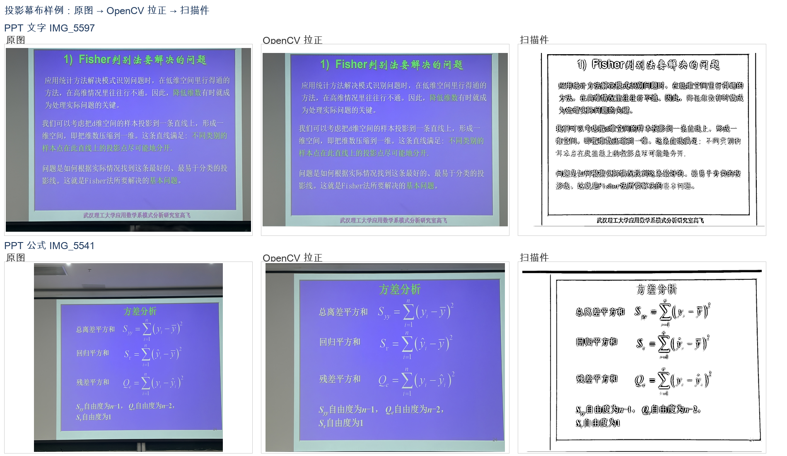
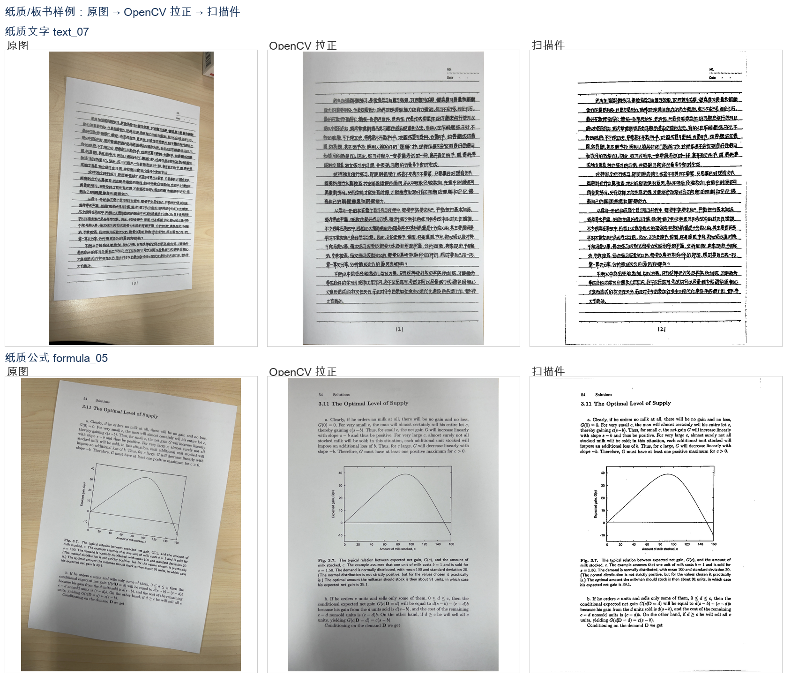
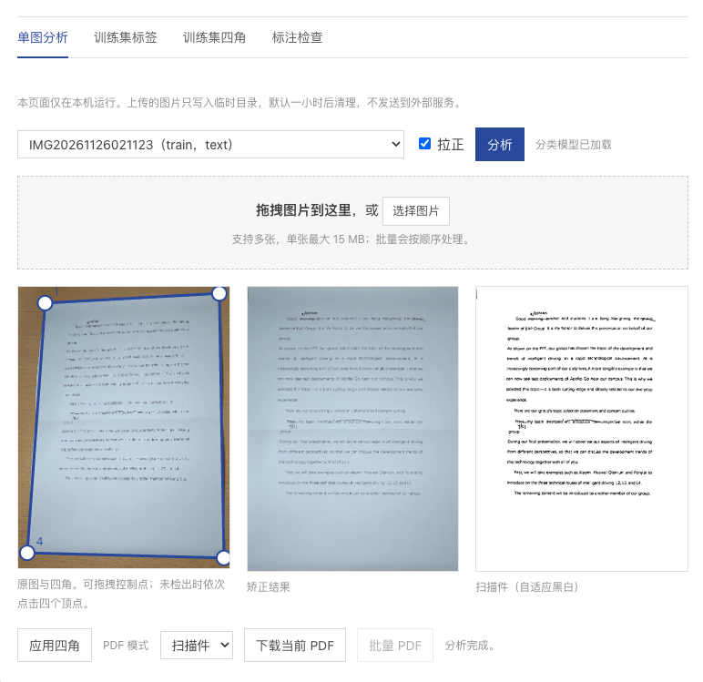
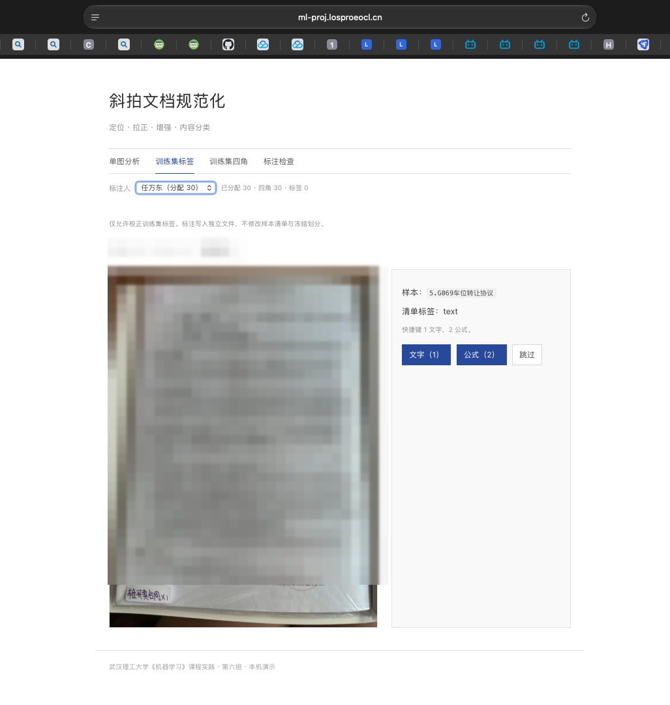
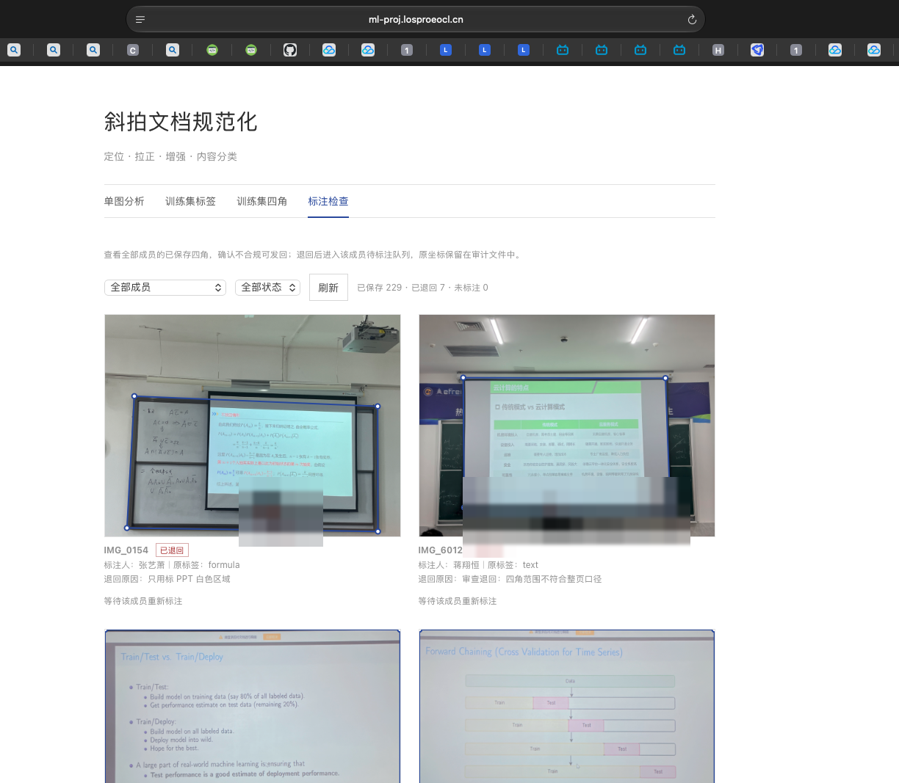

# 斜拍课堂文档自动拉正、去反光与内容归类系统

[](https://github.com/LosproeOcl/wut-ml-task06-doc-normalizer/actions/workflows/ci.yml)


武汉理工大学《机器学习》课程工程实践大作业，第六组，选题编号 Task 06。

计划工期为 2026 年 11 月 25 日至 12 月 9 日，共两周。当前已进入 M4 交付冻结（2026-11-28）：`split_v5` 已冻结（训练 349 / 验证 51 / 测试 72，合格 472 张，含外部测试 30 张；v4 的 338/51/53 与 v3 的 340 张保留为历史口径），矫正、增强、传统基线、MobileNetV3、网页交互与训练集标注工具均已实现；网页已接入载体门控、双分支分类与双路径拉正。v4 时期的验证集路由为 86.27% / 宏 F1 86.19%，M2 的 82% 验证门禁已达到；v4 测试集一次性评估为 **67.92% / F1 67.92%**，未达 85% 验收线。2026-11-28 重建 v5：v4 测试集并入训练集、自采测试样本从 v4 训练集分层留出，并引入外部测试集 30 张；v5 模型全部重训，v5 测试集一次性评估见 `reports/final_test_v5.md`。v4 与 v5 结果不得混用。**口径披露**：v5 更换了测试基准，v4 67.92% 与 v5 不可直接比较；清单级审计确认 v4 无 split 泄漏。合计 93.06% 的 Wilson 下界 84.8% 低于 85%，自采子集 88.10% 与公式召回 83.33% 的下界分别为 75.0% 与 66.4%，“达标”仅指点估计。提交包权重为事故后恢复重建版（验证集路由 84.31% 复现、测试复评 90.28%），正式结果以原权重一次性评估记录为准，见 `reports/recovery_20261128.md`。

## 1. 项目定义

本系统接收一张斜拍的课堂文档照片，文档载体为投影幕布、黑板板书或纸质笔记。系统依次完成三项处理：定位文档四边并执行透视变换，抑制反光并增强对比度，判定页面内容的类别。输出结果为正面矫正图、类别标签与可视化对比图。

上述处理过程划分为三个可独立评估的子问题，如下表所示。

| 子问题 | 输入 | 输出 | 主要评价指标 |
|---|---|---|---|
| 文档定位与矫正 | 斜拍原图 | 四角坐标与正面矫正图 | 自动检出率、下游增益 |
| 去反光与增强 | 矫正图 | 增强图 | 分类准确率增益、清晰度代理指标 |
| 内容归类（文字/公式二分类） | 增强图 | 类别标签与置信度 | 准确率不低于 85%，宏平均 F1 |

自动隐私打码为本组自设扩展功能，已按决定 D-01 取消开发（非课程要求）；数据清洗已完成：含个人信息样本排除出数据集与一切对外材料（`data/manifests/exclusions.csv`），对外配图仅引用无个人信息样本。原设计存档于 `docs/adr/0006` 与 `docs/04` 第 10 节。

系统另提供本机网页交互层，用于课堂演示与训练集标注：手机显示“拍照上传”与“从相册或文件选择”，电脑显示“拍照上传”与“从文件选择”；上传后界面展示原图、四角、矫正图、扫描件、载体门控结果、分类分支与分类概率，支持横向批量队列、逐张切换与四角校准、点击放大，以及当前单张、区间/离散选中项、全部队列三种 PDF 导出。训练集可校正内容标签，也可用扫描式拖拽工具标记四角，结果分别写入独立文件并在训练时合并；四角仅在自动检测失败时作为拉正回退，不修改冻结清单与划分。标注任务按 8 名组员分配，前端可按标注人筛选队列；“标注检查”页汇总全部成员的四角记录，可逐条发回重标并保留退回原因。方案见 `docs/adr/0010` 至 `docs/adr/0016` 与 `docs/03` 第 13 节。网页默认只绑定 `127.0.0.1:54312`，结果临时保存，不写入数据集。

### 1.1 当前进展与实验结论

| 项目 | 当前结果 | 说明 |
|---|---|---|
| 传统基线 | 验证集 76.5% | `reports/baseline_classic.md` |
| MobileNetV3 主模型 | 验证集 80.39% / 宏 F1 79.03% | `exp-cnn-05`，`reports/cnn_validation.md` |
| 屏幕检测 fallback | 自采验证 82.35% | 可选分支，仅多对 1 张，`reports/screen_detection.md` |
| PPT/纸质稿载体门控 | 外部验证 100%，自采验证 51/51；训练集审计 336/338 | 已接入网页主链路；高置信错误可用手动重试，`reports/carrier_routing.md` |
| 纸质稿内容分支（v4 历史） | 集成验证 80.00% | `paper-cnn-extctl-01/43/44` 三模型平均，`reports/web_integration.md` |
| 外部预训练零样本 | 340 张真实数据 54.41% | 等于全判 text，不能直接使用，`reports/pretrained_zero_shot.md` |
| 外部文本对照 | 平衡权重 3 种子 80.00%–86.67%，均值 83.33%；两组无权重种子 42 均为 66.67% | 增益来自类别权重，不能归因于数据来源，`reports/external_control.md` |
| 网页双分支路由（v4 历史） | 验证 86.27% / 86.19%；测试 **67.92% / 67.92%** | PPT 分支换用 `exp-cnn-ppt-dedup-fw`；测试集未达 85%，见 `reports/final_test.md` |
| PPT 空间偏度优化 | 合成 30°/40° 完整链路 71.4%→81.0% | 门控 TTA + 阈值 0.3 已启用，可环境变量回退；待真实偏度样本复核，`docs/15` |
| 新增 102 张 PPT 增训 | 去重 + 公式权重 0.5：PPT 验证 95.24%（20/21） | 超过旧模型 90.48%，已替换网页 PPT 分支默认权重 |
| **v5 重训（当前口径）** | 路由验证 84.31% / 83.81%；PPT 95.24%，纸质 76.67% | 门控 `carrier-gate-v5-01`、PPT `exp-cnn-ppt-v5`、纸质 `paper-cnn-v5-s45`/`s47`、CNN `exp-cnn-v5`、SVM `exp-svm-v5` |
| **v5 测试集一次性评估** | **93.06% / 宏 F1 92.65%**（CI 86.11%–98.61%）；自采 42 张 88.10%，外部 30 张 100% | 外部子集全部为文字类纸质页；公式召回 83.33%；已达 85% 门禁，见 `reports/final_test_v5.md` |

完整变更见 [`CHANGELOG.md`](CHANGELOG.md)，全部运行索引见 `reports/run_index.csv`。多维度评估图见 `reports/figures/eval_*.png`（300 dpi）与同名 SVG，说明见 `reports/web_integration.md`。

### 1.2 效果示例（原图 → OpenCV 拉正 → 扫描件）





上图为自采数据集样本的实际链路输出：原图经载体门控进入对应分支，OpenCV 拉正（Canny 50/150）后输出扫描件（自适应二值化），覆盖投影幕布文字/公式与纸质文字/公式四类。对外示例均选用不含人脸与可识别个人信息的样本；原图不纳入版本控制，效果图由 `scripts/make_readme_examples.py` 重新生成，完整评估图见 `reports/figures/`。

### 1.3 网页与标注演示

| 单图分析 | 训练集标注 | 标注检查 |
|---|---|---|
|  |  |  |

网页默认只绑定 `127.0.0.1:54312`，结果写入临时目录，不写回数据集。上传后依次展示原图与四角、矫正图、扫描件、载体门控与分类概率；支持四角拖拽、批量队列、按载体手动重试与三种 PDF 导出。训练集标注按人分配队列，标签与四角写入独立文件，训练时合并，不修改冻结清单与划分；“标注检查”页汇总全组四角记录，可逐条发回重标并保留退回原因。标注过程图已做模糊化处理。


## 2. 与选题手册的对应关系

| 手册要求 | 本项目对应安排 |
|---|---|
| 校内自采 200 至 320 张斜拍照片，覆盖不同角度与光照 | v3 合格 340 张；2026-11-27 新增两批共 102 张 PPT 训练样本，v4 共 442 张；2026-11-28 v5 另引入外部测试 30 张（只进 test）；手册数量为建议值（D-02）；采集规则见 `docs/04-数据采集与标注规范.md` |
| 文档四角与四边完整入画 | 列为采集准入条件，并纳入质检清单 |
| 两类典型内容（数学公式、纯文字）保持均衡 | 主指标为内容二分类；四格归档保留作辅助分析，见 `docs/adr/0008` |
| 传统机器学习基线采用版面密度或边缘方向特征，配合支持向量机与随机森林 | 规划模块 `classify/classic.py` |
| 轻量深度学习对比采用 MobileNetV3 | 规划模块 `classify/cnn.py`，选型理由见 `docs/adr/0003` |
| 测试集准确率不低于 85%，给出传统方法与深度学习的对比表 | 见 `docs/06-评估与验收方案.md` |
| 输出六至八张并排可视化结果与典型错误案例分析 | 产物存放于 `reports/figures/`，分析模板见 `docs/templates/` |
| 提供一至两张实地采数留证照片 | 存放于 `docs/assets/` |

选题手册正文要求覆盖两类典型内容，评估部分要求四分类准确率。两处表述存在口径差异。任课教师已确认按内容二分类（文字/公式）的准确率评价（OQ-01 已销项）；载体与内容四格归档结构保留，用于归档与辅助分析，见 `docs/adr/0008-评估口径确认为内容二分类.md`。现有样本以投影幕布为主，纸质与板书设配额下限并优先补采，登记为风险 R-19。

## 3. 阶段交付物

| 编号 | 交付物 | 文件 | 状态 |
|---|---|---|---|
| D0.1 | 项目立项书 | `docs/00-项目立项书.md` | 已完成 |
| D0.2 | 需求规格说明 | `docs/01-需求分析.md` | 已完成 |
| D0.3 | 可行性分析报告 | `docs/02-可行性分析.md` | 已完成 |
| D0.4 | 架构设计说明书 | `docs/03-架构设计.md` | 已完成 |
| D0.5 | 数据采集与标注规范 | `docs/04-数据采集与标注规范.md` | 已完成 |
| D0.6 | 项目计划与分工 | `docs/05-项目计划与分工.md` | 已完成 |
| D0.7 | 评估与验收方案 | `docs/06-评估与验收方案.md` | 已完成 |
| D0.8 | 工程规范与协作流程 | `docs/07-工程规范与协作流程.md` | 已完成 |
| D0.9 | 跨平台环境与复现方案 | `docs/08-跨平台环境与复现方案.md` | 已完成 |
| D0.10 | 风险登记与开放问题 | `docs/09-风险登记与开放问题.md` | 已完成 |
| D0.11 | 架构决策记录 | `docs/adr/` | 已完成 |
| D0.12 | 参考实现调研 | `docs/10-参考实现调研.md` | 已完成 |
| D0.13 | 部署与访问 | `docs/11-部署与访问.md` | 已完成 |
| D0.14 | 实验与运行日志规范 | `docs/12-实验与运行日志规范.md` | 已完成 |
| D0.15 | 外部数据使用说明 | `docs/13-外部数据使用说明.md` | 已完成 |
| D0.16 | 屏幕检测与载体门控 | `docs/14-屏幕检测方案.md` | 已完成 |
| D0.17 | 空间偏度优化调研 | `docs/15-空间偏度优化调研.md` | 已完成 |
| D1.0 | 算法实现与实验 | `src/`、`tests/`、`scripts/`、`web/` | 已完成：v5 全链路测试 93.06% / 宏 F1 92.65%，104 项测试通过 |
| D1.1 | 开发者视角开发历程报告 | `docs/16-开发历程报告.docx` / `.pdf` | 已完成（v1.5，51 页） |
| D1.2 | 小组成员及其分工（贡献量化） | `docs/18-小组成员及其分工.docx` | 已完成 |

文档阅读顺序见 `docs/README.md`。

## 4. 仓库结构

```text
.
├── README.md                 项目说明与总索引
├── CHANGELOG.md              功能、实验与文档变更记录
├── CONTRIBUTORS.md           贡献者与 PR #1 选择性采纳记录
├── CONTRIBUTING.md           协作约定
├── docs/                     阶段设计文档
│   ├── 00-项目立项书.md
│   ├── 01-需求分析.md
│   ├── 02-可行性分析.md
│   ├── 03-架构设计.md
│   ├── 04-数据采集与标注规范.md
│   ├── 05-项目计划与分工.md
│   ├── 06-评估与验收方案.md
│   ├── 07-工程规范与协作流程.md
│   ├── 08-跨平台环境与复现方案.md
│   ├── 09-风险登记与开放问题.md
│   ├── 10-参考实现调研.md
│   ├── 11-部署与访问.md
│   ├── 12-实验与运行日志规范.md
│   ├── 13-外部数据使用说明.md
│   ├── 14-屏幕检测方案.md
│   ├── 15-空间偏度优化调研.md
│   ├── 16-开发历程报告.docx / .pdf
│   ├── 17-合成投影PPT试点.md
│   ├── 18-小组成员及其分工.docx
│   ├── adr/                  架构决策记录
│   ├── assets/               实地采数留证照片与示意图
│   ├── record-img/           网页、标注与识别过程截图
│   └── templates/            实验记录与错误案例分析模板
├── data/
│   ├── raw_samples/          图片样本目录，二进制文件不纳入版本控制
│   ├── release/              打码后的发布副本，用于对外材料
│   ├── manifests/            样本清单
│   ├── annotations/          四角坐标等可选标注
│   └── splits/               数据集划分文件
├── configs/                  配置规范与示例
├── env/                      依赖声明
├── src/                      源代码（数据层、矫正、增强、分类、训练与评估）
├── tests/                    单元测试（104 项）
├── notebooks/                探索性分析
├── scripts/                  运维与一次性脚本
├── runs/                    训练产物与模型权重，纳入提交包分发
├── web/                      本机网页交互层
│   ├── README.md             结构与接口说明
│   ├── app.py                FastAPI 应用
│   ├── schemas.py            请求模型
│   ├── services.py           处理链路与结果缓存
│   └── static/               原生 JavaScript 界面
└── reports/                  报告、图表与可视化产物
    ├── run_index.csv         全部实验运行索引
    ├── figures/              诊断图与对比图
    ├── carrier_routing.md    PPT/纸质稿载体门控实验
    ├── pretrained_zero_shot.md 外部预训练零样本评估
    └── screen_detection.md   幕布检测与 fallback 评估
```

## 5. 样本上传说明

1. 原始照片统一放入 `data/raw_samples/00_inbox/`。不要重命名，不要压缩，不要通过即时通讯软件传输，以免二次压缩并丢失图像元数据。
2. 依据 `docs/04-数据采集与标注规范.md` 完成类别判定与命名后，归档至对应的四个子目录。
3. 在 `data/manifests/sample_manifest.csv` 中登记样本信息。该清单是样本的唯一可信来源。
4. 图片文件默认不纳入版本控制，仅提交目录结构、清单与标注文件。原因与替代方案见 `docs/adr/0005`。
5. 每位组员提交一至两张实地采数过程照片至 `docs/assets/`，作为实验报告的留证材料。
6. 对外使用的图像不得含可识别个人信息：敏感样本按 D-01 排除；`data/release/` 中既有打码副本已停用，不得引用。

### 5.1 自采数据集获取

原始照片不纳入版本控制，442 张合格样本以加密压缩包发布在 GitHub Release（tag `dataset-self-v5`），解压口令经微信群单独发送给任课教师、不写入仓库。

| 项目 | 内容 |
|---|---|
| Release | `dataset-self-v5` |
| 资产名 | `dataset-self-442-encrypted.zip` |
| 大小 | 1,126,447,306 字节（约 1.05 GiB） |
| SHA-256 | `f2a5489d3463bedc0cdfece75b7df917d8c6c6b384c3797ee43c5b2280d2e597` |
| 解压口令 | 不写入仓库，经微信群单独发送 |

```bash
gh release download dataset-self-v5 --repo LosproeOcl/wut-ml-task06-doc-normalizer
unzip -P <口令> dataset-self-442-encrypted.zip -d data/raw_samples/
```

解压后得到 `01_ppt_text`、`02_ppt_formula`、`03_paper_text`、`04_paper_formula` 四个目录，与仓库内 `data/raw_samples/README.md` 的约定一致；逐张元数据见 `data/manifests/sample_manifest_v5.csv`，划分见 `data/splits/split_v5.json`。外部公开数据集（SmartDoc、SCB、Tobacco-3482、IM2LATEX-100K、IAM）的来源、许可与用途见 `docs/13-外部数据使用说明.md`。

目录名称与类别代码的对应关系：

| 目录 | 类别代码 | 含义 |
|---|---|---|
| `01_ppt_text` | `ppt_text` | 投影幕布，纯文字 |
| `02_ppt_formula` | `ppt_formula` | 投影幕布，含公式 |
| `03_paper_text` | `paper_text` | 纸质或板书，纯文字 |
| `04_paper_formula` | `paper_formula` | 纸质或板书，含公式 |
| `99_unlabeled` | 无 | 类别存疑，待数据负责人裁定 |

以上为归档标签。评估标签由配置映射为内容二分类（文字/公式），见 `docs/adr/0008`。

## 6. 运行环境

组员设备涵盖 ARM 架构的 macOS、x86 架构的 Windows 与 Linux。为保证结果一致，本项目采用以下约定：

- 正式评估统一在中央处理器上执行，避免不同加速设备带来的数值差异；
- 主方案为 Docker 多架构镜像，分别原生构建 `linux/arm64` 与 `linux/amd64`，不使用指令集模拟；
- 备用方案为组内共用 Linux 虚拟机，用于耗时较长的训练任务；
- 依赖清单与已知问题见 `docs/08-跨平台环境与复现方案.md`。

## 6.1 线上演示

演示入口为 https://ml-proj.losproeocl.cn，使用 Nginx Basic Auth，用户名 `t06`，口令保存在本机密钥库 `t06-web-basic`。应用运行在本机 54312，Server1 只通过 SSH 反向隧道做反向代理，不部署代码、不保存图像。GitHub Pages 只能托管静态文件，无法运行 FastAPI/模型，因此不用于完整 webapp。部署细节见 `docs/11-部署与访问.md`。

## 7. 团队分工

| 角色 | 姓名 | 主要职责 |
|---|---|---|
| 项目负责人、架构、算法主责 | 余青阳 | 计划、架构、环境、集成与最终交付；算法路线（矫正增强、传统基线、深度学习）统一主责，参与数据规范评审与质量抽查；统一归口课程考核口径，主持各里程碑验收判定，负责与任课教师的口径确认及答辩材料合规终审 |
| 数据负责人 | 张毅卓 | 采集规范、样本清单、质量检查与数据划分；余青阳参与规范评审与抽查，全体成员参与采集 |
| 矫正与增强 | 任万东 | 边缘检测、透视变换与对比度增强 |
| 传统机器学习 | 王康琦 | 特征工程与传统分类基线 |
| 轻量深度学习 | 蒋翔恒 | MobileNetV3 迁移学习与训练 |
| 评估 | 张艺萧 | 指标实现、消融实验与统计检验 |
| 可视化与报告 | 孔泽宇 | 结果组图、图表与报告排版 |
| 工程与复现 | 李念 | 容器、命令行工具、持续集成与复现核验 |

上述分工为建议方案。经组内确认后，以 `docs/05-项目计划与分工.md` 中的分工表为准。外部贡献与 PR 处理记录见 [`CONTRIBUTORS.md`](CONTRIBUTORS.md)；PR #1 的清单校验思路已选择性重写为 `scripts/check_manifest.py` 与 `scripts/check_dataset.py`，原作者张毅卓（@qingwu0731）以 Co-authored-by 记录。

### 7.1 贡献量化

贡献采用可复核的加权点数制，逐项计数与分成员说明见 [`docs/18-小组成员及其分工.docx`](docs/18-小组成员及其分工.docx)。

> 个人点数 = 采集×1 + 四角×2 + 主责实验×2 + 主笔文档×8 + 工程交付×10 + 里程碑/审计×20 + 岗位责任分；
> 占比 = 个人点数 ÷ 全组 3,705 × 100%，按最大余数法校平到 100.0%。

| 成员 | 角色 | 加权点数 | 占比 |
|---|---|---:|---:|
| 余青阳 | 项目负责人、架构与算法主责 | 1,017 | 27.5% |
| 张毅卓 | 数据负责人 | 374 | 10.1% |
| 任万东 | 矫正与增强 | 375 | 10.1% |
| 王康琦 | 传统机器学习 | 394 | 10.6% |
| 蒋翔恒 | 轻量深度学习 | 411 | 11.1% |
| 张艺萧 | 评估 | 386 | 10.4% |
| 孔泽宇 | 可视化与报告 | 375 | 10.1% |
| 李念 | 工程与复现 | 373 | 10.1% |
| **合计** | | **3,705** | **100.0%** |

## 8. 学术规范与数据合规

- 评估图像须由本组在校内实地采集，不得使用公开数据集或网络图片替代；外部公开数据只用于预训练初始化或仅训练辅助，不得进入自采验证/测试；
- 不得调用在线光学字符识别接口完成识别任务；
- 拍摄时应避开路人正脸、姓名、学号与联系方式；无法避开时，纳入数据集前须做遮挡处理，并按 `docs/04` 第 10 节完成打码与复核；
- 外部数据仅用于预训练初始化或仅训练辅助，不进入自采验证/测试；报告中须声明来源、数量、许可与用途；
- 引用他人代码或论文须注明出处。

## 9. 使用范围

本仓库内容仅用于本课程的学习与考核。

## 10. 文档修订记录

| 日期 | 内容 |
|---|---|
| 2026-11-25 | M0 设计文档初版；按两周工期重排计划；增加隐私打码设计与参考实现调研 |
| 2026-11-25 | 设计评审修订：统一跨文档数字与字段口径，修正流程矛盾，补齐追踪矩阵与环境步骤，新登记开放问题 OQ-09 |
| 2026-11-25 | OQ-01 确认为内容二分类（ADR-0008）；配额改为内容均衡优先、纸质下限与优先补采；登记 R-19 载体不均衡风险 |
| 2026-11-25 | 风险弥补方案并入登记册：细化 R-19 补采与增强措施、R-04 降级链；新增 R-20 小样本评估可靠性；合成数据使用约束入维护规则 |
| 2026-11-26 | 决定 D-01：停止敏感样本手动打码，25 张改为排除出数据集与对外使用；另排除存疑 3 张、低分辨率 3 张；冻结 split_v1 |
| 2026-11-26 | 编码阶段启动：TDD 实现数据层 manifest/split 模块（15 项单元测试）；清单回填 device/shot_at、修正标识撞车与重复登记；新增机器可读排除表 exclusions.csv；划分 counts 按分组归属重算（240/52/53） |
| 2026-11-26 | D-01 同步至全部文档：FR-16 至 18、UC-05、E8、任务 3.6 等标记暂缓，配置 privacy.enabled 关闭；shooter 缩写统一为 yqy |
| 2026-11-26 | 核对课程原文更正 D-01 口径：取消的是自设自动打码能力（非课程要求），数据清洗已完成即合规；OQ-09 关闭，不可裁剪清单更正为数据清洗与材料不含个人信息 |
| 2026-11-26 | 数据完整性核验发现 `IMG_6111.JPG` 缺失且被分入验证集；排除表新增 `missing_file`（累计 32 行），重建 `split_v3`（236/51/53），配置与文档同步；数据层新增文件存在性校验 |
| 2026-11-26 | R-03 部分通过：arm64 原生镜像构建成功，容器内环境自检通过、26 项测试通过；x86 侧待组员机器或共用虚拟机复核 |
| 2026-11-26 | 矫正模块 TDD 完成：四边形检测、顶点排序、透视变换，13 项测试通过；160 张实测自动检出率 82%，未检出样本在网页调整四角，见 `reports/rectify_detection.md` |
| 2026-11-26 | 补充网页交互规划：FastAPI 加原生 JavaScript，支持上传、四阶段展示、四角拖拽与参数开关；取消离线人工四角标注（ADR-0009、ADR-0010） |
| 2026-11-26 | 增强模块 TDD 完成：光照校正、CLAHE、去噪，9 项测试通过；20 张实测中位耗时 13.5 ms，见 `reports/enhance_validation.md` |
| 2026-11-26 | 决定 D-02：手册 200 至 320 张为建议值，340 张全部保留；样本量上限问题销项 |
| 2026-11-26 | 传统基线完成：1836 维特征，调参后验证集 76.5%，消融与错例见 `reports/baseline_classic.md` |
| 2026-11-26 | 网页快速原型：Typecho 风格界面、四阶段展示、四角拖拽、训练集标签校正；标注独立存放，训练脚本可合并（ADR-0011） |
| 2026-11-26 | 训练集四角工具：自动建议四角、拖拽确认、独立保存并在训练时覆盖（ADR-0012） |
| 2026-11-26 | 排除 4 张非课堂样本，重建 `split_v3`（236/51/53，合格 340）；保留 25 条有效四角，v3 自动基线复验 76.5% |
| 2026-11-26 | 训练集标注按 8 人分配，已有 25 条四角归余青阳，其余均分为 5 人 30 张、3 人 29 张；前端增加标注人筛选；四角框支持整体拖动，自动点换算到原图坐标 |
| 2026-11-26 | MobileNetV3 首轮验证 66.7%，低于传统基线 76.5%；记录为对比实验，待调参后再比较 |
| 2026-11-26 | MobileNetV3 第二轮（拉正不增强）验证 74.5%，仍低于基线；错例与调参方向见 `reports/cnn_validation.md` |
| 2026-11-26 | 屏幕检测：SCB 幕布检测器、屏幕存在性门控与 fallback 评估；门控 fallback 82.35%，仅多对 1 张，作为可选分支 |
| 2026-11-27 | 网页：拍照/相册/文件上传、批量校准、点击放大、横向队列、区间/离散/全部 PDF 导出；修复大图上传卡死；手机端合并相册与文件入口 |
| 2026-11-27 | 模型：新增 PPT/纸质稿载体门控与纸质稿专用模型；外部预训练零样本在 340 张真实数据上仅 54.41%，确认不能直接使用 |
| 2026-11-27 | 文档：新增 `CHANGELOG.md` 与 ADR-0016；同步更新需求、架构、评估、风险、部署、实验日志、外部数据与报告索引 |
| 2026-11-27 | 取消 GitHub Pages 部署：静态托管无法运行 FastAPI/模型，完整 webapp 只在本机与现有 Server1 反向代理运行 |
| 2026-11-27 | 完成空间偏度调研：合成偏度压力测试显示瓶颈在载体门控；门控 TTA + 阈值 0.3 将 30°/40° 从 71.4% 提升到 81.0%，待真实偏度样本复核 |
| 2026-11-27 | 数据复核：按人工修正同步 11 张样本的 file/label 并重算 split_v3 哈希；分组与计数不变，旧标签指标需重跑 |
| 2026-11-27 | 新增 93 张 PPT 幕布样本：人工分为 36 公式 / 57 文字，只加入训练集，生成 `split_v4`（329/51/53）；val/test 不变 |
| 2026-11-27 | 第二批 inbox 9 张 PPT 文字页实拍（2 张幻灯片多角度）登记入 train，`split_v4` 更新为 338/51/53；四角标注由余青阳完成 |
| 2026-11-27 | 处理 PR #1：未直接合并旧分支；选择性重写 `check_manifest.py`、`check_dataset.py` 两个只读校验脚本，原作者张毅卓（@qingwu0731）以 Co-authored-by 记录到 `CONTRIBUTORS.md` |
| 2026-11-27 | PPT 专属模型 `exp-cnn-ppt-dedup-fw` 验证 95.24% / 宏 F1 92.93%，替换网页 PPT 分支；全链路验证集 86.27% / 宏 F1 86.19% |
| 2026-11-27 | 修复上传大图卡死：分析端点改线程池、加并发闸门与像素上限；选图改用 Blob URL 懒加载；多页 PDF 导出增加逐页校准门禁 |
| 2026-11-27 | 网页接入双分支：载体门控 → 纸质稿 CNN 集成 / PPT CNN → SVM 兜底；结果卡显示载体与分支徽标，健康检查报告 `routing`；验证集 88.24% |
| 2026-11-27 | 四角标注 338/338 完成；新增 PPT/纸质学习四角模型，定位 L2 0.1314 / 0.1347 |
| 2026-11-27 | 上线双路径拉正：分类用 OpenCV 视图，显示/PDF 用学习四角；新增“拉正显示”切换 |
| 2026-11-27 | 门控质量兜底：`uncertain` 标记 + 按 PPT/纸质手动重试；不自动跨分支切换 |
| 2026-11-27 | M3 测试集一次性评估：当前链路 67.92% / F1 67.92%，95% CI 54.72%–81.13%，未达 85%；M4 阻塞，先复核测试标签与文字/公式边界 |
| 2026-11-27 | 新增 6 张多维度评估图（PNG 300 dpi + SVG）与 `reports/web_integration.md`；新增 ADR-0017 |
| 2026-11-28 | 重建 `split_v5` 并重训全部模型；v5 测试集一次性评估 93.06% / 宏 F1 92.65%，M4 交付冻结 |
| 2026-11-28 | 开发者报告 v1.5（51 页）与《小组成员及其分工》（docs/18）定稿；README 补充数据集 Release、贡献量化与网页/标注示例，效果图改用无个人信息样本 |
