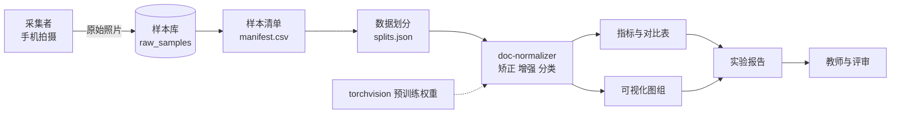
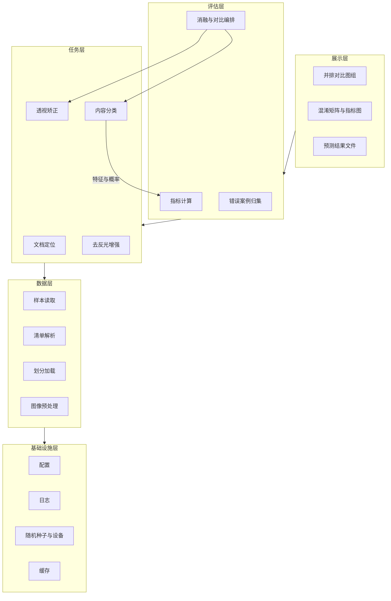
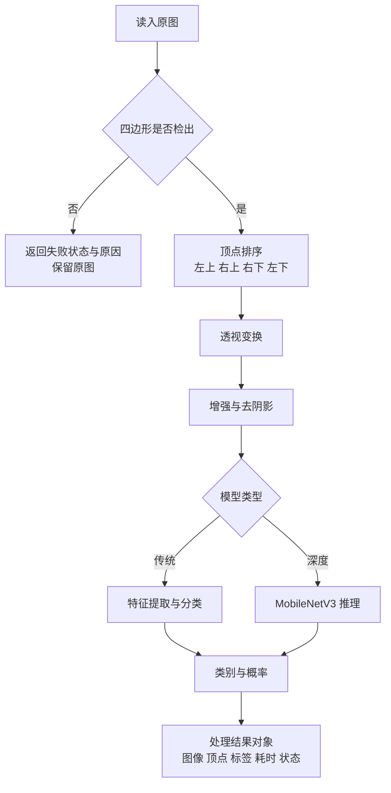
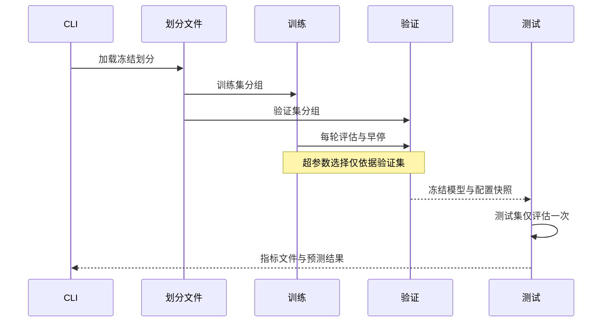
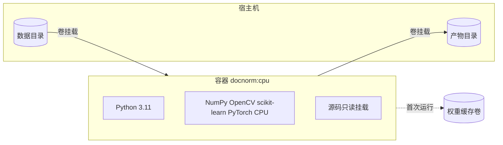
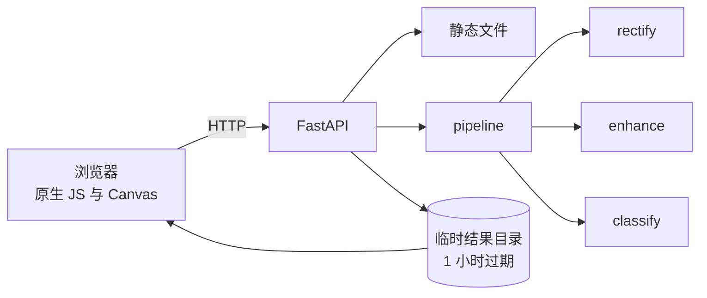

# 架构设计说明书

| 项目 | 内容 |
|---|---|
| 文档编号 | T06-ADD-001 |
| 版本 | v1.0 |
| 架构风格 | 分层管道结构，配合可替换策略 |
| 设计原则 | 结果可复现、模块可替换、运行离线、单机中央处理器、模块间仅通过数据契约通信 |

## 1. 设计目标

1. 每个子问题可独立评估。定位、矫正、增强与分类任一环节出现偏差时，能够单独定位并替换，不影响其他环节。
2. 两条技术路线共享同一套数据与评估入口，保证传统方法与深度学习方法的对比条件一致。
3. 同一份配置能够复现同一组指标，平台差异由容器与固定随机种子吸收。
4. 失败状态可见。任一环节失败均输出明确状态，不得静默降级。

## 2. 系统上下文



系统边界为本地文件处理，不依赖任何在线服务。外部输入仅有自采图像与预训练权重。

## 3. 分层结构



分层约束如下。

1. 禁止跨层反向依赖。任务层不得直接读取配置文件，只能使用注入的配置对象。
2. 任务层各模块之间仅通过数据结构通信，包括文档四边形、矫正图像与预测结果三种结构，不共享全局状态。
3. 展示层只消费评估层输出的标准表格，不得自行计算指标，以避免指标口径分裂。

## 4. 模块设计

模块路径对应计划中的源码包 `src/docnorm/`。当前阶段仅保留目录与说明，不包含实现。表中建议负责人为模块执行人；任务主责与参与分配以 `05-项目计划与分工.md` 第 6 节为准，算法与集成类模块由余青阳统一主责。

| 模块 | 职责 | 输入 | 输出 | 主要依赖 | 建议负责人 |
|---|---|---|---|---|---|
| `data/manifest.py` | 校验清单，生成样本索引 | 样本清单文件 | 样本对象列表 | pandas、pydantic | 张毅卓 |
| `data/split.py` | 按文档页分组划分，冻结划分文件 | 样本对象列表、划分比例 | 划分文件 | scikit-learn | 张毅卓 |
| `data/loader.py` | 读取图像，校正方向，限制尺寸 | 文件路径 | 图像数组 | OpenCV、Pillow | 张毅卓 |
| `rectify/detector.py` | 检测边缘与轮廓，生成四边形候选并择优 | 原始图像 | 四边形或空值 | OpenCV | 任万东 |
| `rectify/warp.py` | 顶点排序、透视变换、输出尺寸推断 | 原始图像、四边形 | 矫正图 | OpenCV、NumPy | 任万东 |
| `enhance/clahe.py` | 亮度通道的直方图均衡、去阴影与锐化 | 矫正图 | 增强图 | OpenCV | 任万东 |
| `features/classic.py` | 提取版面密度、边缘方向与方向梯度直方图特征 | 增强图 | 特征向量 | scikit-image、OpenCV | 王康琦 |
| `classify/classic.py` | 特征标准化、支持向量机与随机森林的训练与推理 | 特征向量 | 类别与概率 | scikit-learn | 王康琦 |
| `classify/cnn.py` | MobileNetV3 迁移学习、训练、推理与权重导出 | 增强图 | 类别与概率 | PyTorch、torchvision | 蒋翔恒 |
| `pipeline.py` | 串联单图处理流程，产出中间结果 | 原始图像 | 处理结果对象 | 上述模块 | 余青阳 |
| `eval/metrics.py` | 计算准确率、F1、混淆矩阵与置信区间 | 预测结果表 | 指标字典 | scikit-learn | 张艺萧 |
| `eval/runner.py` | 批量实验编排与配置快照 | 实验配置 | 结果行与产物 | pandas | 张艺萧 |
| `viz/figures.py` | 绘制四角叠加图、并排图组与统计图 | 处理结果 | PNG 图像 | matplotlib | 孔泽宇 |
| `cli.py` | 命令行入口 | 命令行参数 | 退出码 | argparse 或 typer | 李念 |
| `web/app.py` | 本机网页服务与接口 | HTTP 请求 | HTML、JSON、图像 | FastAPI、Uvicorn | 李念 |
| `web/schemas.py` | 请求与响应模型 | 字典 | Pydantic 模型 | pydantic | 李念 |
| `web/static/` | 原生 JavaScript 界面 | 浏览器事件 | Canvas、DOM | 无构建链 | 孔泽宇 |

## 5. 关键流程

### 5.1 单图推理



### 5.2 顶点排序规则

1. 按横纵坐标之和取最小值作为左上顶点，取最大值作为右下顶点。
2. 按纵坐标与横坐标之差取最小值作为右上顶点，取最大值作为左下顶点。
3. 通过多边形面积符号校验顶点顺序为顺时针或逆时针，必要时翻转。
4. 校验四边形面积占画面比例处于 5% 至 98% 区间。超出区间视为定位失败，防止将整幅画面或噪声点误判为文档。

### 5.3 训练与评估流程



测试集仅允许在最终评估时评估一次，用于最终指标；此后的复现核验可再运行，但不得据此调参。该约束用于避免以测试集调参造成的隐性过拟合。指标口径见 `06-评估与验收方案.md`。

### 5.4 隐私打码流程（取消，D-01）

自动打码能力为本组自设扩展功能，按 D-01 取消开发；数据清洗（敏感样本排除）已完成。原流程、模块与审计设计不进入实现，仅保留于 ADR-0006 与 ADR-0007 作为历史记录。

## 6. 数据契约

### 6.1 样本清单

样本清单文件为 `data/manifests/sample_manifest.csv`，字段定义如下。

| 字段 | 类型 | 必填 | 说明 |
|---|---|---|---|
| `sample_id` | 字符串 | 是 | 全局唯一，取文件名去掉扩展名 |
| `file` | 字符串 | 是 | 相对于 `data/raw_samples/` 的路径 |
| `label` | 枚举 | 是 | 归档标签 `ppt_text`、`ppt_formula`、`paper_text`、`paper_formula`；评估标签由配置映射为 `text`、`formula` |
| `doc_page_id` | 字符串 | 是 | 文档页分组键，同一页面的多角度拍摄必须相同 |
| `shooter` | 字符串 | 是 | 拍摄者姓名缩写 |
| `device` | 字符串 | 是 | 手机型号 |
| `scene` | 枚举 | 是 | `classroom`、`corridor`、`dorm`、`outdoor` |
| `angle_deg` | 整数 | 是 | 估计倾斜角，取值范围 0 至 90 |
| `lighting` | 枚举 | 是 | `natural`、`ceiling`、`side_lamp`、`backlight` |
| `resolution` | 字符串 | 是 | 宽乘高，单位像素 |
| `shot_at` | 日期 | 是 | 拍摄日期 |
| `notes` | 字符串 | 否 | 反光、遮挡或存疑说明 |
| `privacy_masked` | 布尔 | 是 | 历史字段，D-01 后固定为 `false`，不得引用发布副本 |
| `privacy_regions` | 整数 | 是 | 历史字段，无打码时填 0 |
| `release_file` | 字符串 | 否 | 历史字段，D-01 后为空 |

### 6.2 划分文件

`data/splits/split_v2.json` 的结构如下。

```json
{
  "version": "v1",
  "seed": 42,
  "group_key": "doc_page_id",
  "ratio": {"train": 0.7, "val": 0.15, "test": 0.15},
  "groups": {"train": [], "val": [], "test": []},
  "counts": {"train": 0, "val": 0, "test": 0},
  "frozen_at": "YYYY-MM-DD",
  "manifest_sha256": "清单文件哈希，评估前校验，不一致时终止"
}
```

### 6.3 预测结果

`predictions.csv` 的字段为：样本标识、真实类别、预测类别、两类概率（文字、公式）、是否正确、是否低置信度、是否自动矫正、处理耗时。

### 6.4 处理结果对象

处理结果对象包含以下字段：样本标识、状态、四边形顶点、矫正图、增强图、预测类别、各类概率、处理耗时。状态取值为成功、矫正失败、输入非法三种。

## 7. 接口设计

### 7.1 命令行接口

```bash
docnorm rectify  --input data/raw_samples/00_inbox --output reports/rectified
docnorm predict  --input <目录或清单> --model classic_svm|classic_rf|cnn --config configs/default.yaml
docnorm train    --model cnn --config configs/default.yaml --out runs/exp-001
docnorm evaluate --pred runs/exp-001/predictions.csv --split data/splits/split_v2.json
docnorm report   --samples <样本清单> --out reports/figures
docnorm serve    --host 127.0.0.1 --port 8000
```

统一约定：提供 `--json` 选项输出机器可读结果。退出码 0 表示成功，2 表示输入错误，3 表示处理失败。批量处理中部分样本失败时返回 0，并在汇总中标注失败数量。

### 7.2 Python 接口

```text
detect_document(image) -> DocumentQuad | None
rectify(image, quad, out_size=None) -> ndarray
enhance(image, method="clahe") -> ndarray
ClassicClassifier.fit(X, y) / .predict_proba(X)
CnnClassifier.fit(train_loader, val_loader) / .predict_proba(images)
run_pipeline(image, config, classifier) -> PipelineResult
```

### 7.3 配置结构

配置分为数据、矫正、增强、分类、隐私、网页与运行时七段。所有实验差异只允许体现在配置中，不得通过修改代码分支实现。示例见 `configs/default.yaml`。

## 8. 错误处理与状态

| 状态 | 触发条件 | 处理方式 |
|---|---|---|
| 输入非法 | 文件损坏、非图像格式、短边小于 256 像素 | 跳过并记录，不计入指标分母 |
| 矫正失败 | 未检出四边形或面积校验未通过 | 保留原图，可标记为人工兜底样本，单独统计成功率 |
| 低置信度 | 最大类别概率低于 0.55，阈值可配置 | 正常输出，同时写入待复核清单 |
| 成功 | 全部环节正常 | 输出完整字段 |

系统不得在定位失败时以整幅图像强行执行透视变换后继续分类。该做法会污染指标，且难以在结果中发现。

## 9. 技术选型

| 层次 | 选型 | 理由 | 未采用的备选方案及原因 |
|---|---|---|---|
| 图像处理 | OpenCV，无图形界面版本 | 透视变换、形态学与直方图均衡功能完备，两种架构均有预编译包 | Pillow 功能不足；scikit-image 速度较慢 |
| 传统特征 | scikit-image 方向梯度直方图，配合自实现版面特征 | 方法经典，结果可解释，中央处理器运算快 | 深度特征与对比实验目的冲突 |
| 传统分类器 | 支持向量机与随机森林 | 小样本条件下稳定，可输出概率 | XGBoost 需额外依赖，收益不明确 |
| 深度模型 | MobileNetV3-Small | 参数量约 250 万，中央处理器可训练，具备 ImageNet 预训练权重 | ResNet50 参数量过大；ViT 对样本量要求过高 |
| 指标计算 | scikit-learn | 标准实现，避免自实现引入错误 | 自实现指标容易出错 |
| 绘图 | matplotlib 与 seaborn | 课程通用，输出可控 | 交互式绘图库对静态报告无必要 |
| 配置管理 | YAML 配合数据类校验 | 可读性好，便于版本比对 | 命令行硬编码不利于复现 |
| 依赖管理 | pip 依赖文件配合容器 | 组员熟悉度最高 | Poetry 在 Windows 上偶发锁定问题 |
| 容器 | Docker 多架构构建 | 解决 ARM 与 x86 架构分裂 | 裸机统一无法实现 |
| 打码方式（取消，D-01） | 实心填充，可选像素化 | 像素层面不可逆 | 高斯模糊存在被部分还原的风险 |

## 10. 部署视图



系统为单容器结构，网页服务与处理链路同进程，无数据库。权重缓存使用命名卷，避免镜像重建后重复下载。macOS 设备宜将数据置于容器可写层内运行，以规避外置卷挂载的读写开销。

## 11. 安全与隐私

1. 推理容器可禁用网络，全部环节在本地完成。
2. 日志不输出含用户名的绝对路径，统一记录相对路径。
3. 报告中出现的人像与姓名一律遮挡。
4. 权重文件不纳入版本控制，由脚本按校验和下载。
5. 对外材料不得包含个人信息；敏感样本已按 D-01 排除，历史打码副本停用，不得引用。

## 12. 扩展点

| 扩展需求 | 预留方式 |
|---|---|
| 调整分类口径 | 评估标签由配置 `classify.label_map` 映射，流程无需修改；当前为内容二分类，见 ADR-0008 |
| 替换检测算法 | 定位模块以接口形式注入 |
| 替换骨干网络 | 骨干名称由配置项决定 |
| 增加增强算法 | 在增强模块下新增策略并注册 |

## 13. Web 交互层

### 13.1 目标

网页层只服务本机演示，不承担生产部署。它负责三件事：把图片送进处理链路，把中间结果可视化，允许用户在自动检测失败时拖拽四角并重新计算。

### 13.2 结构



### 13.3 接口

| 方法 | 路径 | 用途 | 返回 |
|---|---|---|---|
| GET | `/` | 页面 | HTML |
| GET | `/api/health` | 健康检查 | 状态、模型、版本 |
| GET | `/api/samples` | 列出可选样本 | 样本标识、类别 |
| GET | `/api/samples/{id}/thumb` | 样本缩略图 | JPEG |
| POST | `/api/analyze` | 上传文件或指定样本 | 结果标识、四角、阶段图 URL、分类与耗时 |
| POST | `/api/analyze/{id}/corners` | 提交调整后的四角 | 更新后的阶段图与分类 |
| GET | `/api/results/{id}/{stage}.png` | 获取阶段图 | PNG |

`stage` 取值为 `original`、`quad`、`rectified`、`enhanced`。

### 13.4 请求与响应

分析响应至少包含以下字段。

```text
result_id: str
status: ok | rectify_failed | invalid_input
quad: [[x,y] ×4] | null
method: edge | mask_quad | mask_rect | manual | none
label: text | formula | null
probabilities: {text: float, formula: float}
runtime_ms: float
rectified_url / enhanced_url: str
```

四角调整请求体为四个点坐标，服务端重新执行排序、透视变换、增强与分类，返回同一结构。

### 13.5 前端行为

1. 上传区支持拖拽与文件选择，限制 15 MB 与常见图片格式。
2. 原图上叠加四边形与四个可拖拽控制点；拖动结束触发重新计算。
3. 阶段视图采用并排或页签切换，显示分类概率条与耗时。
4. 矫正、增强、模型选择三个控件直接影响请求参数。
5. 检测失败时显示提示与原图，允许手动放置四角或跳过矫正。
6. 不加载外部 CDN、字体与统计脚本，界面为中文。

### 13.6 临时结果与安全

1. 结果写入容器内临时目录，默认 1 小时过期，服务重启即清空。
2. 默认绑定 `127.0.0.1:8000`，不对外网开放。
3. 上传文件按内容校验，不信任扩展名；文件名不参与路径拼接。
4. 单请求并发限制为 2，避免中央处理器被占满。

### 13.7 测试

接口使用 FastAPI TestClient 做契约测试，覆盖健康检查、样本列表、上传分析、四角调整与非法输入。前端采用人工验收清单，不引入浏览器自动化框架。

## 14. 架构决策索引

架构决策记录见 `docs/adr/`。任何偏离本设计的实现须在提交说明中陈述理由，并补充相应决策记录。
