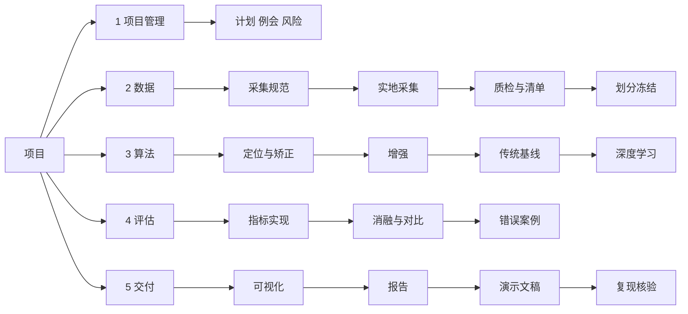

# 项目计划与分工

| 项目 | 内容 |
|---|---|
| 文档编号 | T06-PLAN-001 |
| 版本 | v1.0 |
| 计划周期 | 六个相对周，实际周次待与教学日历对齐 |
| 关键路径 | 采集、划分冻结、传统基线、深度学习训练、指标达标 |

## 1. 工作分解结构

| 编号 | 任务 | 产出 | 前置任务 |
|---|---|---|---|
| 1.1 | 立项、需求与架构 | 本仓库设计文档 | 无 |
| 1.2 | 环境验证，双架构冒烟测试 | 环境验证记录 | 无 |
| 2.1 | 采集规范宣讲 | 全员确认 | 1.1 |
| 2.2 | 分三轮采集 | 合规样本不少于 240 张 | 2.1 |
| 2.3 | 质量检查、登记与补充采集 | 样本清单 | 2.2 |
| 2.4 | 划分冻结 | 划分文件 | 2.3 |
| 3.1 | 文档定位与透视矫正 | 矫正模块 | 2.4 |
| 3.2 | 去反光与增强 | 增强模块 | 3.1 |
| 3.3 | 手工特征与传统分类 | 基线指标 | 3.2 |
| 3.4 | MobileNetV3 迁移学习 | 深度模型指标 | 3.2 |
| 3.5 | 命令行工具与批处理 | 可运行处理链路 | 3.3、3.4 |
| 4.1 | 指标实现与图表 | 指标文件与图表 | 3.3 |
| 4.2 | 消融与对比实验 | 对比表 | 3.4 |
| 4.3 | 错误案例归集 | 案例集 | 4.2 |
| 5.1 | 并排可视化图组 | 六至八张图像 | 3.5 |
| 5.2 | 实验报告 | 文档文件 | 4.3 |
| 5.3 | 汇报演示文稿 | 演示文件 | 5.1 |
| 5.4 | 复现核验 | 核验记录 | 5.2 |

## 2. 里程碑与出口条件

| 里程碑 | 时间 | 出口条件 | 负责人 |
|---|---|---|---|
| M0 立项与设计 | 第一周末 | 设计文档齐备；双架构容器冒烟测试通过 | 余青阳 |
| M1 数据就绪 | 第二周末 | 合规样本不少于 240 张；清单完整；划分文件冻结 | 张毅卓 |
| M2 基线可用 | 第三周末 | 矫正与增强可运行；传统基线产出指标；深度学习模型可完成训练 | 任万东、王康琦、蒋翔恒 |
| M3 指标达标 | 第四周末 | 四分类准确率不低于 85%；拉正前后对比完成 | 蒋翔恒、张艺萧 |
| M4 交付冻结 | 第六周末 | 报告、演示文稿、代码与复现核验全部完成 | 余青阳 |

里程碑未通过时，不进入下一阶段的关键任务，仅允许补充数据或修复缺陷。若进度落后，优先裁剪深度学习的扩展实验，保证指标、对比表与可视化三项核心交付。

## 3. 周度安排

| 周次 | 数据工作 | 算法工作 | 评估与交付工作 |
|---|---|---|---|
| 第一周 | 制定规范，试拍 20 张 | 环境冒烟测试，阅读相关文献 | 设计文档定稿 |
| 第二周 | 三轮采集、质检与划分冻结 | 定位与矫正原型 | 指标脚本框架 |
| 第三周 | 补充采集 | 增强与传统基线 | 首轮传统方法指标 |
| 第四周 | 补充采集，仅加入训练集 | 深度学习训练与参数调整 | 首轮深度学习指标 |
| 第五周 | 数据冻结 | 消融实验 | 报告图表与错误案例 |
| 第六周 | 无 | 缺陷修复 | 报告、演示文稿与复现核验 |

## 4. 分工方案

下表为建议分工。经组内确认后，以本表为执行依据。

| 姓名 | 角色 | 主要职责 | 次要职责 | 验收标准 |
|---|---|---|---|---|
| 余青阳 | 项目负责人、架构 | 计划、架构、集成、环境与复现 | 报告统稿 | 仓库可运行，文档一致 |
| 张毅卓 | 数据负责人 | 采集规范、样本清单、质量检查与数据划分 | 补充采集调度 | 清单可追溯率 100% |
| 任万东 | 矫正与增强 | 边缘检测、透视变换与对比度增强 | 定位失败分析 | 矫正成功率不低于 90% |
| 王康琦 | 传统机器学习 | 特征工程与传统分类基线 | 特征重要性分析 | 基线指标与混淆矩阵完整 |
| 蒋翔恒 | 轻量深度学习 | MobileNetV3 训练、推理与权重导出 | 数据增强策略 | 准确率不低于 85% 且可复现 |
| 张艺萧 | 评估 | 指标实现、划分校验、消融与统计检验 | 错误案例归因 | 对比表口径正确 |
| 孔泽宇 | 可视化与报告 | 结果图组、统计图表与报告排版 | 演示文稿制作 | 六至八张图可直接引用 |
| 李念 | 工程与复现 | 容器、命令行工具、脚本与持续集成 | 依赖问题排查 | 双架构冒烟测试通过 |

### 4.1 职责分配矩阵

R 表示负责执行，A 表示最终负责，C 表示需被咨询，I 表示需被告知。

| 活动 | R | A | C | I |
|---|---|---|---|---|
| 数据采集 | 全体成员 | 张毅卓 | 余青阳 | 全体成员 |
| 划分冻结 | 张毅卓 | 余青阳 | 张艺萧 | 全体成员 |
| 传统基线 | 王康琦 | 余青阳 | 张艺萧 | 全体成员 |
| 深度学习训练 | 蒋翔恒 | 余青阳 | 王康琦 | 全体成员 |
| 指标口径 | 张艺萧 | 余青阳 | 蒋翔恒 | 全体成员 |
| 报告与演示文稿 | 孔泽宇 | 余青阳 | 全体成员 | 任课教师 |

## 5. 协作机制

| 项目 | 约定 |
|---|---|
| 例会 | 每周一次，时长 30 分钟，内容为上周产出、本周计划与阻塞事项 |
| 异步沟通 | 问题记录于仓库议题，提交请求中注明关联议题编号 |
| 文件共享 | 代码与文档通过版本控制共享；图像存于本地目录并以清单管理，不通过即时通讯软件传递 |
| 决策记录 | 影响指标口径或系统结构的决策须留存记录，形式为架构决策记录或议题结论 |
| 阻塞处理 | 阻塞事项在 24 小时内指定负责人 |

## 6. 风险登记摘要

完整登记见 `09-风险登记与开放问题.md`。

| 编号 | 风险 | 概率 | 影响 | 应对措施 | 负责人 |
|---|---|---|---|---|---|
| R-01 | 采集样本不合格导致返工 | 中 | 高 | 先试拍 20 张并集体评审，通过后批量拍摄 | 张毅卓 |
| R-02 | 同一文档页跨集合导致数据泄漏 | 中 | 高 | 强制登记分组键，划分脚本断言校验 | 张艺萧 |
| R-03 | ARM 与 x86 环境不一致 | 高 | 中 | 多架构容器，评估统一在中央处理器上执行 | 李念 |
| R-04 | 四分类准确率未达 85% | 中 | 高 | 第五周设置缓冲，必要时降级为二分类 | 蒋翔恒 |
| R-05 | 幕布反光导致定位失败 | 中 | 中 | 反光样本专项分析，提供人工兜底 | 任万东 |
| R-06 | 中央处理器训练耗时过长 | 中 | 中 | 224 像素输入、冻结骨干与早停 | 蒋翔恒 |
| R-07 | 学期末课程冲突导致人力不足 | 高 | 中 | 预先定义最小可交付集 | 余青阳 |
| R-08 | 组员不熟悉版本控制工具 | 中 | 低 | 第一周安排一次 20 分钟培训 | 李念 |

## 7. 最小可交付集

若第五周结束时仍未达到指标要求，按以下顺序裁剪，保证课程交付完整。

1. 保留内容：数据集与清单、拉正与增强模块、传统基线、拉正前后对比、六张可视化图。
2. 降级内容：四分类合并为文字与公式二分类，仍按 85% 口径汇报。
3. 放弃内容：深度学习的高级增强实验、特征重要性分析、附加统计检验。
4. 不放弃内容：错误案例分析。该项为报告评分要点。
