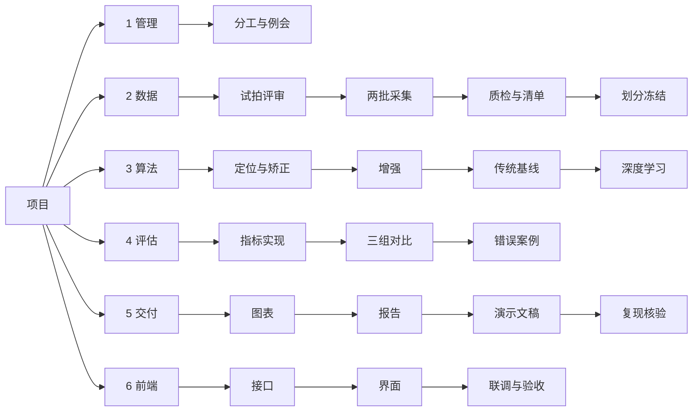

# 项目计划与分工

| 项目 | 内容 |
|---|---|
| 文档编号 | T06-PLAN-001 |
| 版本 | v2.0，两周工期版 |
| 计划周期 | 2026 年 11 月 25 日至 12 月 9 日，共 15 个日历日 |
| 有效工作日 | 11 天。11 月 28 日、29 日与 12 月 5 日、6 日为周末，用于集中采集与文档撰写 |
| 关键路径 | 采集、划分冻结、传统基线、深度学习训练、最终评估、报告交付 |

## 0. 执行状态（2026-11-27）

| 里程碑 | 状态 | 说明 |
|---|---|---|
| M0 立项与设计 | 已完成 | 设计文档、双架构容器与口径确认完成 |
| M1 数据就绪 | 已完成 | v3 的 340 张合格样本冻结为 236/51/53；2026-11-27 新增两批共 102 张 PPT 训练样本，`split_v4` 为 338/51/53（442 张）；2026-11-28 重建 `split_v5`（349/51/72，含外部测试 30 张，只进 test） |
| M2 基线可用 | **通过（2026-11-27）** | 传统基线 76.5%；单模型 CNN 80.39%；网页双分支路由验证集 86.27%，达到 82% 门禁 |
| M3 指标达标 | **通过（2026-11-28，v5 口径，附披露）** | v5 测试集一次性评估 93.06% / F1 92.65%（bootstrap CI 86.11%–98.61%；Wilson 84.8%–97.0%）；自采子集 88.10%、公式召回 83.33%，二者 Wilson 下界（75.0%/66.4%）低于 85%/70%，仅点估计达标；v5 更换了测试基准（旧测试并入训练、自采测试由旧训练池留出），v4 的 67.92% 不可直接比较；清单级审计确认 v4 无 split 泄漏，错误归因见 `reports/error_cases_v5.md`、`reports/final_test_v5.md` |
| M4 交付冻结 | **通过（2026-11-28）** | v5 复现核验通过（逐样本一致，tag m3-v5-20261128）；开发者报告 v1.6（51 页，含里程碑标准、动态目录 A–D 与权重恢复说明）与评估图按 v5 重生成；演示文稿按组内决定由《开发历程报告》+《小组成员及其分工》（docs/18）替代；对外材料合规抽查通过；提交包与自采数据集加密归档（GitHub Release dataset-self-v5）就绪。提交包内权重为事故后恢复重建版，验证集路由 84.31% 复现、测试集复评 90.28%（正式结果 93.06% 以原权重记录为准，见 `reports/recovery_20261128.md`） |

## 1. 工期约束说明

课程仅余两周。本计划对常规安排作如下调整。

1. 样本目标定为 240 张，符合手册每人 25 至 40 张的建议，且高于 200 张的总体下限。实际合格 340 张，手册数量为建议值（D-02），全部保留。
2. 采集集中为两批，分别在 11 月 27 日与 28 日完成。
3. 传统基线与深度学习训练并行推进，不再串行等待。
4. 实验范围收敛为三组必做对比：传统方法与深度学习方法、拉正前后、增强开关。特征消融改为可选。
5. 降级决策点定于 12 月 2 日，即中期门禁当日。若当日验证集准确率低于 82%，立即启动降级方案。
6. 缓冲时间仅保留两天，即 12 月 7 日与 8 日。进度偏差超过一天即触发范围裁剪。

## 2. 工作分解结构

| 编号 | 任务 | 产出 | 前置任务 | 主责与参与 |
|---|---|---|---|---|
| 1.1 | 分工确认与文档评审 | 分工表签署 | 无 | 余青阳主责，全体参与 |
| 1.2 | 环境搭建与双架构冒烟测试 | 环境验证记录 | 无 | 李念主责，余青阳参与 |
| 2.1 | 试拍 20 张并集体评审 | 评审结论 | 1.1 | 张毅卓主责，余青阳、任万东参与评审 |
| 2.2 | 第一批采集，约 120 张 | 原始照片 | 2.1 | 张毅卓主责，全体成员参与 |
| 2.3 | 第二批采集，约 120 张 | 原始照片 | 2.2 | 张毅卓主责，全体成员参与 |
| 2.4 | 质量检查、清单登记与补充采集 | 样本清单 | 2.3 | 张毅卓主责，余青阳参与抽查 |
| 2.5 | 划分冻结 | 划分文件 | 2.4 | 张毅卓主责，张艺萧参与复核 |
| 3.1 | 文档定位与透视矫正 | 矫正模块 | 2.1 | 余青阳主责，任万东执行 |
| 3.2 | 去反光与增强 | 增强模块 | 3.1 | 余青阳主责，任万东执行 |
| 3.3 | 特征提取与传统分类 | 基线指标 | 3.2 | 余青阳主责，王康琦执行 |
| 3.4 | MobileNetV3 迁移学习 | 深度模型指标 | 3.2 | 余青阳主责，蒋翔恒执行 |
| 3.5 | 命令行工具与批处理 | 可运行链路 | 3.3、3.4 | 余青阳主责，李念执行 |
| 3.6 | 隐私检测与打码工具（取消开发，D-01） | 敏感样本排除表（已交付）；自动打码能力非课程要求，不再开发 | 1.2 | 李念主责，张毅卓参与 |
| 4.1 | 指标实现与校验 | 指标文件 | 2.5 | 张艺萧主责，余青阳参与口径评审 |
| 4.2 | 三组对比实验 | 对比表 | 3.4 | 张艺萧主责，蒋翔恒、王康琦参与 |
| 4.3 | 错误案例归集 | 案例集 | 4.2 | 孔泽宇主责，张艺萧参与 |
| 5.1 | 可视化图组 | 六张图像 | 3.5 | 孔泽宇主责，余青阳参与审定 |
| 5.2 | 实验报告 | 文档文件 | 4.3 | 余青阳主责，孔泽宇参与排版 |
| 5.3 | 汇报演示文稿 | 演示文件 | 5.1 | 孔泽宇主责，余青阳参与审定 |
| 5.4 | 复现核验 | 核验记录 | 5.2 | 李念主责，张艺萧参与 |
| 6.1 | 网页接口与结果缓存 | API 与接口测试 | 3.5 | 李念主责，余青阳参与 |
| 6.2 | 网页界面、四角交互与训练集标注 | 拍照/相册/文件上传、批量队列、四阶段展示、点击放大、PDF 导出、标签与四角拖拽保存 | 6.1 | 孔泽宇主责，李念参与 |
| 6.3 | 网页联调与验收 | 演示流程与接口记录 | 6.2、4.2 | 余青阳主责，孔泽宇、李念参与 |

## 3. 逐日计划

| 日期 | 星期 | 数据工作 | 算法工作 | 评估与交付 | 当日出口 |
|---|---|---|---|---|---|
| 11-25 | 三 | 采集规范宣讲 | 环境搭建启动 | 设计文档交付 | 分工确认 |
| 11-26 | 四 | 试拍 20 张并评审 | 环境冒烟测试 | 与教师确认分类口径 | M0 门禁通过 |
| 11-27 | 五 | 第一批采集 120 张 | 定位与矫正原型 | 指标脚本框架 | 采集过半 |
| 11-28 | 六 | 第二批采集 120 张 | 矫正与增强 | 清单录入 | 采集完成 |
| 11-29 | 日 | 质检、补拍、划分冻结 | 特征提取 | 划分复核 | M1 门禁通过 |
| 11-30 | 一 | 数据冻结 | 矫正与增强完成；命令行框架 | 首轮传统指标 | 基线可运行 |
| 12-01 | 二 | 无 | 传统基线调优；网页接口骨架 | 指标校验 | 传统基线定稿；接口可返回结果 |
| 12-02 | 三 | 无 | 深度学习首轮训练；上传与阶段展示 | 中期评审 | M2 门禁通过；网页可上传 |
| 12-03 | 四 | 无 | 深度学习调参；四角交互与联调 | 拉正与增强消融 | 主模型确定；四角可调整 |
| 12-04 | 五 | 无 | 缺陷修复；网页接口与界面缺陷修复 | 测试集最终评估 | 指标确认 |
| 12-05 | 六 | 无 | 无 | 对外材料合规抽查（D-01）；图表与错误案例 | M3 门禁通过 |
| 12-06 | 日 | 无 | 无 | 报告与演示文稿初稿；网页演示彩排 | 初稿完成；演示流程走通 |
| 12-07 | 一 | 无 | 缺陷修复 | 复现核验 | 复现通过 |
| 12-08 | 二 | 无 | 无 | 材料终审与答辩演练 | 材料冻结 |
| 12-09 | 三 | 无 | 无 | 提交与答辩 | M4 交付 |

## 4. 里程碑与出口条件

| 里程碑 | 日期 | 出口条件 | 负责人 |
|---|---|---|---|
| M0 立项与设计 | 11-26 | 设计文档齐备；双架构容器构建与环境自检通过；试拍样本评审通过；分类口径经项目负责人与任课教师确认 | 余青阳 |
| M1 数据就绪 | 11-29 | 合规样本不少于 240 张；实际 340 张按 D-02 保留；清单完整；划分文件冻结 | 张毅卓 |
| M2 基线可用 | 12-02 | 传统基线与深度学习各完成一次训练与评估；验证集准确率不低于 82%；降级与否由项目负责人当日判定 | 余青阳（蒋翔恒、王康琦执行） |
| M3 指标达标 | 12-05 | 测试集准确率不低于 85%；三组对比实验完成 | 张艺萧 |
| M4 交付冻结 | 12-09 | 报告、演示文稿、代码与复现核验全部完成；对外材料通过合规抽查（D-01）；网页演示可完成上传、批量队列、四阶段展示、四角调整、点击放大与 PDF 导出 | 余青阳 |

门禁未通过时，当日例会决定是否启动降级方案，不得顺延超过一天。

## 5. 降级与裁剪规则

### 5.1 触发条件

| 时点 | 检查项 | 未达标时的动作 |
|---|---|---|
| 11-27 | 第一批合格率 | 低于 80% 时，当日调整拍摄方法，不再追加批次 |
| 11-29 | 合规样本总量 | 少于 200 张时，启用试拍样本与首批样本，测试集比例调整为 70/10/20 |
| 12-02 | 验证集准确率 | 低于 82% 时，调整骨干网络或输入分辨率，必要时补充训练样本后重跑 |
| 12-04 | 测试集准确率 | 低于 85% 时，当日例会决定执行已登记的降级方案或补充训练集后重建划分并重跑全部实验；调整过程须在报告中说明，不得以反复评估测试集的方式调参 |
| 12-07 | 复现核验 | 未通过时，放弃附加统计检验，优先修复主流程 |

### 5.2 裁剪顺序

1. 首先取消特征消融与附加统计检验。
2. 其次取消载体维度的辅助分析，仅保留内容二分类主指标。
3. 再次减少可视化图组数量，由六张减至四张。
4. 最后放弃错误案例中的次要类别，但保留定位失败与类别混淆两类。

### 5.3 不可裁剪内容

以下内容为课程硬性要求，不得取消。

1. 独立测试集评估与准确率指标。
2. 传统方法与深度学习方法的量化对比表。
3. 拉正前后的对比结果。
4. 六至八张并排可视化中的至少四张。
5. 实地采数留证照片。
6. 三类典型错误案例分析。
7. 数据清洗与隐私合规：数据集与对外材料不含个人信息（已完成，排除表见 `data/manifests/exclusions.csv`）。自动打码能力为本组自设扩展功能，非课程硬性要求，按 D-01 取消开发。
8. 网页演示的基础交互：上传、四阶段展示、四角调整。可在样式与附加功能上裁剪，但上述三项不得取消。

## 6. 分工方案

分工按“一人主责、多人参与”的方式分配。每项任务有唯一主责人，对产出与进度负责；参与人承担具体执行并接受主责人协调。主责人缺位时，由项目负责人指定代理，不得出现无主责任务。

| 姓名 | 角色 | 主责任务 | 参与任务 | 并行任务 | 验收标准 |
|---|---|---|---|---|---|
| 余青阳 | 项目负责人、架构、算法主责 | 计划与架构（1.1）、处理链路集成（3.5）、算法路线统筹（3.1 至 3.4）、报告统稿（5.2）；课程考核口径归口与答辩材料合规终审 | 采集规范评审与数据质量抽查（2.1、2.4） | 门禁判定、与任课教师确认分类口径与考核要求 | 仓库可运行，材料按期交付，考核要求逐项落实 |
| 张毅卓 | 数据负责人 | 采集规范、清单、质检与划分（2.1、2.4、2.5） | 排除表维护与数据质量抽查 | 补充采集调度 | 清单可追溯率 100% |
| 任万东 | 矫正与增强 | 边缘检测、透视变换与增强（3.1、3.2） | 定位失败分析与网页四角调整支持 | 反光样本专项统计 | 自动检出率不低于 80% |
| 王康琦 | 传统机器学习 | 特征工程与传统基线（3.3） | 深度模型对照与特征重要性分析 | 传统基线调优 | 基线指标完整 |
| 蒋翔恒 | 轻量深度学习 | MobileNetV3 训练与推理（3.4） | 数据增强策略设计 | 训练设备与耗时记录 | 准确率不低于 85% |
| 张艺萧 | 评估 | 指标实现、消融与统计检验（4.1、4.2） | 划分校验（2.5）、复现核验（5.4） | 对比表口径审查 | 对比表口径正确 |
| 孔泽宇 | 可视化与报告 | 图表、报告排版与演示文稿（5.1、5.3） | 网页界面（6.2）、错误案例归集（4.3） | 图表源脚本维护 | 图表与网页可直接演示 |
| 李念 | 工程与复现 | 容器、命令行、脚本与复现核验（1.2、5.4） | 网页接口（6.1）、依赖问题排查 | 双架构冒烟与体积检查 | 双架构冒烟通过、接口测试通过 |

算法线（3.1 至 3.4）由余青阳统一主责，任万东、王康琦、蒋翔恒分别承担矫正增强、传统基线与深度学习的执行；数据线由张毅卓主责，余青阳参与规范评审与质量抽查，全体成员参与采集。

职责分配矩阵如下。R 表示负责执行，A 表示最终负责，C 表示需被咨询，I 表示需被告知。

| 活动 | R | A | C | I |
|---|---|---|---|---|
| 采集 | 全体成员 | 张毅卓 | 余青阳 | 全体成员 |
| 划分冻结 | 张毅卓 | 余青阳 | 张艺萧 | 全体成员 |
| 矫正与增强 | 任万东 | 余青阳 | 张艺萧 | 全体成员 |
| 传统基线 | 王康琦 | 余青阳 | 张艺萧 | 全体成员 |
| 深度学习 | 蒋翔恒 | 余青阳 | 王康琦 | 全体成员 |
| 链路集成与命令行 | 李念 | 余青阳 | 蒋翔恒 | 全体成员 |
| 网页接口与界面 | 孔泽宇、李念 | 余青阳 | 张艺萧 | 全体成员 |
| 指标口径 | 张艺萧 | 余青阳 | 蒋翔恒 | 全体成员 |
| 报告与演示文稿 | 孔泽宇 | 余青阳 | 全体成员 | 任课教师 |
| 考核口径与答辩合规 | 余青阳 | 余青阳 | 张艺萧、张毅卓 | 全体成员 |

## 7. 协作机制

| 项目 | 约定 |
|---|---|
| 例会 | 每日一次，时长 15 分钟，固定在晚间。内容为当日产出、次日计划与阻塞事项 |
| 门禁评审 | 五个里程碑当日增加一次 30 分钟评审，由项目负责人主持并记录判定结论与依据 |
| 异步沟通 | 问题记录于仓库议题，当日回复 |
| 文件共享 | 代码与文档通过版本控制共享；图像存于本地目录并以清单管理 |
| 决策记录 | 影响指标口径或系统结构的决策当日留痕 |
| 阻塞处理 | 阻塞事项在 4 小时内指定负责人 |

## 8. 风险登记摘要

完整登记见 `09-风险登记与开放问题.md`。

| 编号 | 风险 | 概率 | 影响 | 应对措施 | 负责人 |
|---|---|---|---|---|---|
| R-01 | 采集样本不合格导致返工 | 中 | 高 | 11 月 26 日完成试拍评审，通过后批量拍摄 | 张毅卓 |
| R-02 | 同一文档页跨集合导致数据泄漏 | 中 | 高 | 强制登记分组键，划分脚本断言校验 | 张艺萧 |
| R-03 | ARM 与 x86 环境不一致 | 高 | 中 | 11 月 26 日完成双架构冒烟，未通过即改用共用虚拟机 | 李念 |
| R-04 | 内容二分类准确率未达 85% | 中 | 高 | 12 月 2 日设决策点，未达 82% 按降级链执行（冻结主干→微调→Large/320→传统基线兜底） | 蒋翔恒 |
| R-05 | 幕布反光导致定位失败 | 中 | 中 | 反光样本专项统计，提供人工兜底 | 任万东 |
| R-06 | 中央处理器训练耗时过长 | 中 | 中 | 224 像素输入、冻结骨干与早停 | 蒋翔恒 |
| R-07 | 学期末课程冲突，人力不足 | 高 | 高 | 预定义最小可交付集，偏差超过一天即裁剪范围 | 余青阳 |
| R-08 | 组员不熟悉版本控制工具 | 中 | 低 | 11 月 25 日安排 20 分钟培训 | 李念 |
| R-21 | 网页交互挤压算法与报告工期 | 中 | 中 | 限定 1.5 人日；12 月 3 日冻结功能；界面复用命令行链路 | 余青阳 |
| R-21 | 网页交互挤压算法与报告工期 | 中 | 中 | 限定 1.5 人日；12 月 3 日冻结功能，只修缺陷；界面复用命令行链路 | 余青阳 |
| R-15 | 两周工期不足，关键环节延迟 | 高 | 高 | 逐日门禁，12 月 2 日设降级决策点，保留两天缓冲 | 余青阳 |
| R-16 | 隐私信息漏检导致信息泄露 | 中 | 高 | 自动检测仅作候选，强制人工复核并留存审计记录 | 张毅卓 |
| R-19 | 载体分布不均衡，投影幕布占多数 | 高 | 中 | 纸质与板书设下限并优先补采（纸质公式页优先、增加页面多样性）；按内容分层；类权重；按载体分组报告 | 张毅卓 |
| R-20 | 测试集小，单点准确率波动大 | 高 | 中 | 必报置信区间；分组交叉验证选模型；麦克尼马尔检验 | 张艺萧 |
