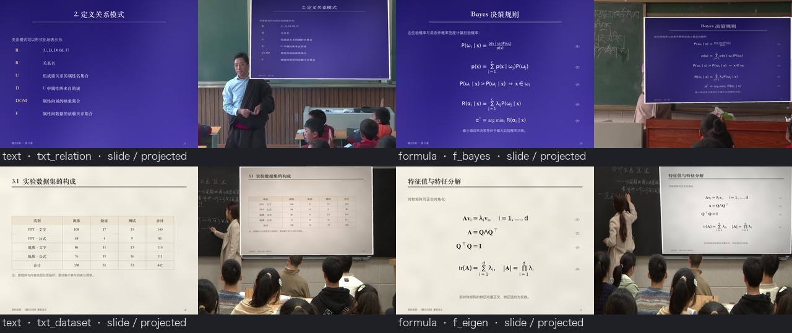
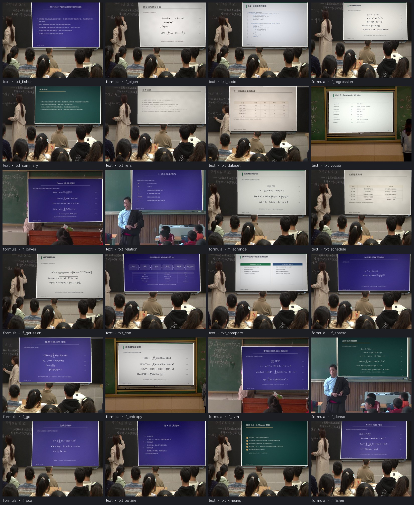

# 合成投影 PPT 页面试点

| 项目 | 内容 |
|---|---|
| 日期 | 2026-11-28 |
| 目标 | 验证“真实教室背景 + 生成课件页 + 投影退化”的合成路线是否足够真实，为是否扩大合成训练集提供依据 |
| 状态 | 24 组示例已生成并完成版式/投影核查；**未进入训练，未用于评估** |
| 产物 | `data/synthetic/ppt_projection_v1/`（24 组，图不入库）、`reports/synth_ppt_preview.jpg`、`reports/synth_ppt_layouts.jpg`、`reports/synth_ppt_pairs.jpg` |
| 脚本 | `scripts/build_synth_ppt_pages.py` |

## 1. 为什么做

公开数据里没有可直接训练“投影幕布 PPT 文字/公式”的实拍集：数字幻灯片缺少投影畸变、反光与环境光；SCB-Dataset 只有屏幕框，没有内容标签。此前直接用 IM2LATEX、Tobacco、IAM 做预训练，在自采真实数据上退化为“全判 text”，说明裁剪图与目标域差距过大。

因此改用“**用公开数据造目标域样本**”：

1. 从 SCB 教师子集取教室背景与 `screen` 框；
2. 按真实课程课件版式生成文字页/公式页；
3. 把课件贴进屏幕，叠加透视、亮度衰减、反光、纹理、模糊与 JPEG；
4. 标签由生成方式直接确定，仅作为训练候选。

## 2. 课件页设计

### 2.1 版式与字体

- 画布 1280×960（4:3），与项目样本比例一致；
- 4 套模板：深紫渐变（理工科课件）、米白讲义页、白底绿色标题条、深青学术模板；
- 字体：宋体（标题/正文）、Hiragino Sans GB（黑体）、Times New Roman（英文/数字）、Menlo（代码）；
- 页脚与页码按模板变化，避免每页都像同一张模板；
- 公式用 matplotlib mathtext（STIX）渲染，按等号对齐，右侧编号；
- 中文说明与公式混排，公式页保留少量“由……计算”的引导语，符合真实推导页。

### 2.2 内容清单

| 文字页（12） | 版式要点 | 公式页（12） | 版式要点 |
|---|---|---|---|
| 关系模式定义 | 术语—解释两列 | Bayes 决策 | 5 行推导 + 编号 |
| 数据集构成 | 五列表格 + 注释 | Fisher 判别 | 散度矩阵、准则函数 |
| Fisher 要解决的问题 | 多行 bullet | 多元线性回归 | 正规方程、帽子矩阵 |
| 快速排序 | Java 代码 + 行号 | SVM 对偶 | 约束、Lagrange、对偶目标 |
| 学术英语词汇 | 单词—词性—释义 | 高斯分布 | 长公式 + 马氏距离 |
| K-Means 算法 | 编号步骤 | 特征分解 | 4 行公式 |
| 两种归一化 | 左右对比面板 | 梯度下降 | 目标、更新式、学习率 |
| CNN 结构 | 流程图 + 层参数表 | 点到超平面距离 | 仅 2 行（稀疏页） |
| 决策树章节 | 多级 bullet | 信息熵 | 熵、互信息、KL |
| 实验进度 | 三列表格 | 拉格朗日乘子 | 约束优化 + KKT |
| 参考文献 | 悬挂缩进 | PCA | 协方差、特征值、投影 |
| 本章小结 | bullet | 正则化与稀疏解 | 6 行密集推导 |

模板×类别分布（24 组）：

| 模板 | 文字 | 公式 |
|---|---:|---:|
| 深紫 | 4 | 6 |
| 米白讲义 | 3 | 1 |
| 白底绿条 | 3 | 4 |
| 深青 | 2 | 1 |

## 3. 投影合成

1. 从 `data/manifests/scb_screen.csv` 取 10 张 1920×1080、屏幕完整且无前景遮挡的教室图；
2. 以 screen 框四角为基础，做 0.3%–1.2% 外扩、1% 抖动与轻微梯形，形成投影四边形；贴边时吸附到画幅边缘；
3. 先用略大的白色底板盖住旧课件残边，再按单应矩阵把 1280×960 课件透视贴入；
4. 叠加：中心亮、边缘暗的投影衰减，轻微偏色，对比度/亮度下降，4%–12% 去饱和，幕布细纹与摩尔纹，顶灯反光，高斯噪声，0.65–1.45 px 模糊，屏幕外溢光，JPEG 76–90；
5. 围绕屏幕裁 1.32–1.62 倍近景，统一到 1280×960，模拟手机拍摄取景；
6. 按生成版式写入 `text` / `formula` 标签，不依赖模型预测。

## 4. 示例

四组“课件原图 / 投影合成”对照：



24 组投影合成预览：



24 张课件页版式：


本地可打开 `data/synthetic/ppt_projection_v1/gallery.html` 逐组查看。

## 5. 核查结果

| 检查项 | 结果 |
|---|---|
| 数量 | 24 组（文字 12 / 公式 12） |
| 分辨率 | 全部 1280×960 |
| 标签 | 24 个唯一 ID，标签由版式确定，无缺失 |
| 背景 | 10 张 SCB 教室图，来自多个教室场景 |
| 模板 | 深紫 10、白底 7、米白 4、深青 3 |
| 文本/公式混淆 | 文字页含少量符号与数字，公式页含中文引导语；符合真实课件而非“纯公式裁剪” |

### 5.1 看起来像真的部分

- 深紫渐变 + 宋体标题 + 白色 bullet，与自采 `IMG_5596/5597` 的课程课件接近；
- 米白讲义页的表格、参考文献页与真实投影的教材页接近；
- 公式按等号对齐、带编号，长公式自动缩放，密集页不会溢出；
- 透视、幕布亮度衰减、顶灯反光、前景学生与教师遮挡组合后，单看一张不容易分辨是合成；
- 教师/学生在前景遮挡屏幕时，遮挡关系是真实的，不是贴图盖住人。

### 5.2 仍然不真实/不够的部分

1. **背景域偏 K12**：SCB 是小学/初中教室，桌椅、学生身高、黑板布置与大学教室不同；当前只有 10 张背景、4 个场景，重复明显。
2. **缺少强遮挡**：为避免把教师身体截断，背景筛选时避开了大面积遮挡；真实数据里教师走到屏幕前、学生举手遮挡很常见。
3. **屏幕边框/底板**：为了让旧课件残边不外露，贴图外沿有约 1%–2% 的白边；部分图上像屏幕白框，部分图上略突兀。
4. **投影退化偏温和**：当前模糊、噪声、摩尔纹、反光都较轻，未覆盖强环境光、失焦、运动模糊、极端偏色。
5. **课件版式仍偏“干净”**：没有复杂公式与图的混排、超长表格、旧版 PPT 艺术字、截图型课件、扫描页投影等。
6. **模板与类别未完全解耦**：米白模板只有 1 张公式页，深青模板公式页也少；若直接训练，模型可能把“米白/表格”当作文字线索。

## 6. 能否用于重训

**当前 24 组只够评审合成效果，不够训练。** 若评审通过，建议按以下试点执行：

1. 扩到 200–300 组，背景至少 40–60 张，覆盖大学教室、不同投影距离、强/弱环境光、教师遮挡；
2. 模板×类别交叉平衡，每个模板至少 20% 的另一类；背景与标签独立分配；
3. 只加入训练集，验证/测试仍用自采 `split_v4`；
4. 只训练 PPT 分支，做 5 折分组 CV、每折 3 个种子；
5. 与当前 PPT 分支对照：CV **70.44% ± 8.24**、OOF **71.71%**；
6. 接受门槛：CV 均值提升 **≥ 2pp**，且 3 个种子方向一致、最差折不下降超过 2pp；否则停止，不扩大合成量；
7. 报告中披露合成数量、模板、背景来源、生成脚本与标签方式。

## 7. 复现

```bash
python3 scripts/build_synth_ppt_pages.py \
  --out data/synthetic/ppt_projection_v1 --n-per-class 12

# 只生成指定数量做快速检查
python3 scripts/build_synth_ppt_pages.py \
  --out data/synthetic/_smoke --n-per-class 2 --limit-text 2 --limit-formula 2
```

脚本固定随机种子 `--seed 2026`；每张图的透视/光照/噪声种子写入 `manifest.csv`。

## 8. v2 训练集（2026-11-28）

评审通过后，在 v1 基础上生成 v2，改用**自采 train PPT 照片**做背景，减少 K12 教室的域差。

| 项目 | v2 |
|---|---|
| 数量 | 160 组（文字 80 / 公式 80） |
| 模板×类别 | 深紫/米白/白底/深青 × 文字/公式，各 20 张 |
| 背景 | 57 个：47 张自采 train PPT（人工四角，按 `doc_page_id` 去重）+ 10 张 SCB 教室图 |
| 背景来源 | `data/manifests/synth_backgrounds_v1.csv` |
| 训练清单 | `data/manifests/synth_ppt_v2_train.csv` |
| 训练入口 | `scripts/train_cnn.py --extra-train-manifest ...` |
| 评估 | 只评估真实 PPT 验证折，合成样本不进入 val/test |

关键约束：

1. 背景只取 `split_v4` 的 **train** 分组，val/test 不进入背景池；
2. 训练时若合成背景的 `doc_page_id` 落在当前 CV 折的验证组，该合成样本会被跳过，避免背景场景泄漏；
3. 合成图 `rectify=0`，避免对已经裁好的图再次拉正；
4. 模板与类别完全交叉平衡，防止模型把模板颜色当成类别捷径。

生成命令：

```bash
PYTHONPATH=src python scripts/build_synth_backgrounds.py   --out data/manifests/synth_backgrounds_v1.csv --per-class 24

python3 scripts/build_synth_ppt_pages.py   --out data/synthetic/ppt_projection_v2 --n-per-class 80   --background-manifest data/manifests/synth_backgrounds_v1.csv   --id-prefix syn-ppt-v2

python3 scripts/build_synth_train_manifest.py   --manifest data/synthetic/ppt_projection_v2/manifest.csv   --out data/manifests/synth_ppt_v2_train.csv
```

训练协议：先跑 fold1 × 3 种子，与 fold1 基线 **77.08%** 比较；若均值提升 ≥ 2pp 且种子方向一致，再跑剩余 4 折 × 3 种子，对照全量 PPT CV **70.44% ± 8.24**。

结果（15 次运行）：

| 折 | 基线 | 合成 v2 | 变化 |
|---|---:|---:|---:|
| fold1 | 77.08% | 82.64% | +5.56pp |
| fold2 | 68.42% | 87.72% | +19.30pp |
| fold3 | 65.22% | 70.29% | +5.07pp |
| fold4 | 66.67% | 75.00% | +8.33pp |
| fold5 | 74.80% | 75.61% | +0.81pp |
| **总体** | **70.44% ± 8.24** | **78.25% ± 7.92** | **+7.81pp** |

宏 F1 **67.25% → 76.07%（+8.82pp）**；OOF **71.71% → 77.56%**，公式召回 **64.3% → 72.6%**。5 折均值全部不低于基线；fold5 仅 +0.81pp，fold3 种子波动仍大。详细表与混淆矩阵见 `reports/synth_ppt_training.md`。

## 9. 结论

1. v1 的 24 组示例证明了版式与投影退化可以达到可评审水平；v2 改成自采 train PPT 人工四角背景后，域差进一步缩小。
2. v2 的 160 组只进训练集；5 折 × 3 种子 CV 从 **70.44%** 提升到 **78.25%（+7.81pp）**，宏 F1 提升 **8.82pp**，OOF 提升 **5.85pp**，满足预设的 +2pp 门槛。
3. 增益主要来自公式类和低分折，fold5 仅 +0.81pp，fold3 仍有较大种子波动，不能把均值提升当成每折都稳定。
4. **测试集未使用**。这组结果支持把合成数据作为 PPT 分支的训练增强候选，但不应直接据此宣称线上提升；接入前还要固定 3 种子集成、在真实验证集复核，并单独评估“同一教室/课程场景”带来的乐观偏差。
5. 只用 4:3 人工四角标注的 16 组示例见 `reports/manual_4x3_sample.md`；这些背景均来自训练集，val/test 未使用。

### 9.1 严格 4:3 版 v3

严格过滤 `|aspect - 4/3| <= 0.05` 后只剩 19 个训练背景，生成 160 组 v3。结果：

| 指标 | 基线 | v2 | v3（仅 4:3） |
|---|---:|---:|---:|
| 5 折准确率 | 70.44% ± 8.24 | **78.25% ± 7.92** | 76.50% ± 6.85 |
| 宏 F1 | 67.25% ± 10.50 | **76.07% ± 8.72** | 74.74% ± 7.77 |
| OOF 准确率 | 71.71% | 77.56% | **78.05%** |
| OOF 公式召回 | 64.3% | 72.6% | **81.0%** |

v3 的定位正确、公式召回最高、跨折更稳，但背景只有 19 个，fold2 折均值比 v2 低约 13pp，整体折均值低 1.75pp。若定位正确优先，选 v3；若折均值优先，v2 仍最高。把 v2/v3 的 3 种子概率平均后 OOF 约 80.0%，仅作探索性候选，未经独立验证。

详细见 `reports/synth_ppt_v3_training.md`。

### 9.2 测试集复验（2026-11-28）

固定模型与阈值 0.5，在 `split_v4` 测试集上推理（不调参）：

| 方法 | PPT 24 张 | 全测试 53 张 |
|---|---:|---:|
| 冻结链路 | **62.50%** | **67.92%** |
| 合成 v2 | 45.83% | 60.38% |
| 合成 v3 | 45.83% | 60.38% |
| v2+v3 | 45.83% | 60.38% |

CV 的提升没有迁移到测试集：合成模型把大量 PPT 文字页判成公式，v2/v3 文字召回只有 40%/33%。原因是合成背景与训练集共享教室/课程场景，CV 偏乐观；测试集域差更大。**因此不把 v2/v3 接入网页或最终链路**，保留冻结链路。详见 `reports/synth_ppt_test.md`。
