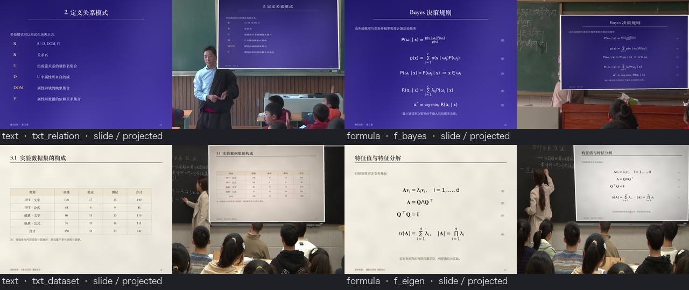

# 合成投影 PPT 页面试点报告

| 项目 | 内容 |
|---|---|
| 日期 | 2026-11-28 |
| 目的 | 观察“SCB 教室背景 + 生成课件 + 投影退化”的合成效果，决定是否扩大为训练集 |
| 样本 | 24 组（文字 12 / 公式 12），1280×960 |
| 结论 | 示例可用于评审；**暂不直接重训**，需先扩大背景与版式多样性、解耦模板与类别 |
| 详细方法 | [`docs/17-合成投影PPT试点.md`](../docs/17-合成投影PPT试点.md) |

## 1. 产物

| 文件 | 内容 |
|---|---|
| `reports/synth_ppt_pairs.jpg` | 4 组“课件原图 / 投影合成”对照 |
| `reports/synth_ppt_preview.jpg` | 24 组投影合成预览 |
| `reports/synth_ppt_layouts.jpg` | 24 张课件页版式 |
| `data/synthetic/ppt_projection_v1/manifest.csv` | 逐样本路径、标签、模板、背景、种子 |
| `data/synthetic/ppt_projection_v1/gallery.html` | 本地画廊（图像不入库） |
| `scripts/build_synth_ppt_pages.py` | 生成脚本，固定种子可复现 |

## 2. 合成方法

1. 课件页：1280×960，深紫/米白讲义/白底绿条/深青四套模板；宋体、黑体、Times、Menlo；公式用 mathtext 按等号对齐并编号。
2. 背景：SCB 教师子集 10 张 1920×1080 教室图，取 `screen` 框，避开前景大面积遮挡。
3. 投影：外扩/抖动四边形，单应透视贴图，白色底板盖旧课件残边；叠加亮度衰减、偏色、降对比、去饱和、幕布纹理、摩尔纹、顶灯反光、噪声、模糊、外溢光与 JPEG。
4. 取景：围绕屏幕裁 1.32–1.62 倍近景，统一 1280×960。
5. 标签：由版式生成器直接写入，不经过模型。

## 3. 核查



- 24 组全部 1280×960，ID 唯一，标签 12/12；
- 背景 10 张（多个教室场景）；
- 模板：深紫 10、白底 7、米白 4、深青 3；
- 文字页覆盖定义、表格、代码、词汇、步骤、对比、流程图、章节、进度、参考文献、小结；
- 公式页覆盖 Bayes、Fisher、回归、SVM、高斯、特征分解、梯度下降、稀疏页、熵、Lagrange、PCA、正则化。

### 3.1 达到预期的部分

- 深紫模板与自采课程课件的标题、bullet、页脚风格接近；
- 公式等号对齐、编号、长公式缩放，密集页不溢出；
- 透视、亮度衰减、反光、前景学生/教师组合自然；
- 教师站在屏幕前时，遮挡关系真实。

### 3.2 不足

1. 背景是 K12 教室，只有 10 张，重复明显；
2. 缺少强遮挡、强环境光、失焦、运动模糊、极端偏色；
3. 贴图外沿有 1%–2% 白边，部分图略像屏幕白框；
4. 米白模板只有 1 张公式页，深青模板公式页也少，模板与类别未完全解耦；
5. 课件版式仍偏干净，缺少复杂图表混排、旧版 PPT 艺术字、截图型课件。

## 4. 是否重训

当前 24 组**只用于评审**。若评审通过，按 `docs/17` 第 6 节执行：

- 扩到 200–300 组、40–60 张背景；
- 模板×类别交叉平衡，背景与标签独立；
- 只进训练集，5 折 CV × 3 种子；
- 对照当前 PPT 分支 CV **70.44% ± 8.24**、OOF **71.71%**；
- 接受门槛：CV 均值提升 ≥ 2pp，种子方向一致，最差折下降 ≤ 2pp；否则停止。

## 5. 复现

```bash
python3 scripts/build_synth_ppt_pages.py \
  --out data/synthetic/ppt_projection_v1 --n-per-class 12
```

生成后打开 `data/synthetic/ppt_projection_v1/gallery.html` 逐组查看。
